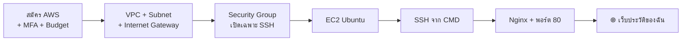

# ☁️ ICT24167 · AWS Cloud Network Lab

> **มหาวิทยาลัยศรีปทุม · คณะเทคโนโลยีสารสนเทศ**
> รายวิชา ICT24167 การบริหารเครือข่ายคอมพิวเตอร์ (Network Management)
> ผู้สอน: อาจารย์อำนาจ คงเจริญถิ่น · ภาคการศึกษาที่ 1/2569

ใน Packet Tracer เราสร้าง Router, Subnet และ ACL กันมาแล้ว ใน Lab ชุดนี้เราจะสร้างสิ่งเดียวกันบน **AWS** แล้วจบด้วย **เว็บไซต์ประวัติของตัวเอง** ที่ใครก็เปิดดูได้จากอินเทอร์เน็ต

---

## 🗺️ เส้นทางการเรียน

| สัปดาห์ | Lab | สิ่งที่ได้ | เวลา |
|---|---|---|---|
| 1 | [**LAB 01 · Cloud Network & Secure Access**](lab01-aws-vpc-ec2-ssh.md) | บัญชี AWS ที่ปลอดภัย, VPC/Subnet ของตัวเอง, Security Group, EC2 และ SSH จาก Windows | 120 นาที |
| 2 | [**LAB 02 · My First Web App**](lab02-my-first-web-app.md) | หน้าเว็บประวัติที่ให้ AI ช่วยเขียน วางบน Nginx และเปิดผ่านพอร์ต 80 | 120 นาที |

---

## 🔗 เชื่อมกับสิ่งที่เรียนมาแล้ว

| สิ่งที่เคยทำใน Packet Tracer / ตำรา | สิ่งที่ตรงกันใน AWS |
|---|---|
| ผังเครือข่ายทั้งหมดของบริษัท | **VPC** (Virtual Private Cloud) |
| แบ่งวง LAN / DMZ ด้วย Subnetting (Ch4-5) | **Subnet** (Public / Private) |
| Router + Default Route ออกอินเทอร์เน็ต | **Route Table** + **Internet Gateway** |
| Host Firewall แบบ Stateful (UFW, Ch11) | **Security Group** ผูกกับ Instance |
| Cisco ACL แบบ Stateless (Ch10) | **Network ACL** ผูกกับ Subnet |
| SSH เข้าเซิร์ฟเวอร์ (Ch8, Ch11) | SSH เข้า **EC2** ด้วย Key Pair |
| Nginx บน Ubuntu (Ch11) | Nginx บน EC2 ที่เปิดให้ทั้งโลกเข้าได้ |

---

## ✅ สิ่งที่ต้องเตรียม

- [ ] คอมพิวเตอร์ **Windows 10/11** (ใช้ CMD / PowerShell ที่มีอยู่แล้ว ไม่ต้องติดตั้งอะไรเพิ่ม)
- [ ] **อีเมล** ที่ยังไม่เคยสมัคร AWS
- [ ] **บัตรเดบิตหรือบัตรเครดิต** (Visa/Mastercard) สำหรับยืนยันตัวตน → อ่าน [ไม่มีบัตรทำอย่างไร](#-ไม่มีบัตรทำอย่างไร)
- [ ] **โทรศัพท์มือถือ** สำหรับรับ SMS/สายยืนยัน และติดตั้งแอป Authenticator (Google Authenticator, Microsoft Authenticator ฯลฯ)
- [ ] จดบันทึก **Public IP** ของเครื่อง EC2 ไว้ในที่ปลอดภัย

### 💳 ไม่มีบัตรทำอย่างไร

AWS ต้องใช้บัตรตอนสมัคร (แม้จะเลือก Free plan ที่ไม่ถูกเรียกเก็บเงินก็ตาม) หากไม่มีบัตร ให้แจ้งผู้สอน เพื่อรับสิทธิ์ใช้ **AWS Academy Learner Lab** แทน ขั้นตอนเหมือนกันเกือบทั้งหมด ยกเว้น Part 0 (สมัครบัญชี) และ Learner Lab จะหยุด Instance เองเมื่อจบ Session

---

## 🛡️ กติกาความปลอดภัย (อ่านก่อนเริ่ม)

> [!CAUTION]
> 1. **ห้าม** แชร์ หรือ commit ไฟล์ `.pem` / `.ppk` / Access Key ขึ้น GitHub หรือส่งในกลุ่มแชต
> 2. **ห้าม** ใช้ root account ทำงานประจำหลังจบ Lab และต้องเปิด MFA เสมอ
> 3. **Stop** Instance ทุกครั้งเมื่อจบคาบ และ **Terminate** เมื่อจบภาคเรียน
> 4. ภาพหน้าจอที่ส่งต้องไม่เห็นรหัสผ่าน, เลขบัตร หรือเนื้อหาของ Private Key
> 5. ทดสอบ / สแกนพอร์ตได้ **เฉพาะเครื่องของตัวเอง** เท่านั้น

> [!NOTE]
> หน้าจอ AWS Console เปลี่ยนบ่อย ชื่อปุ่มในเอกสารนี้อาจต่างจากที่เห็นเล็กน้อย ให้มองหาความหมายที่ใกล้เคียง หรือถามผู้สอน

---

## 📦 การส่งงาน

แต่ละ Lab มีหัวข้อ **Evidence Pack** ท้ายเอกสาร ให้รวมภาพหน้าจอเป็น PDF ไฟล์เดียว ตั้งชื่อ `LAB0X_รหัสนักศึกษา.pdf` แล้วส่งตามช่องทางที่ผู้สอนกำหนด

---

อ้างอิง: ตำรา ICT24167 บทที่ 4-5 (Subnetting), 8 (Transport/Ports), 10 (Firewall), 11 (UFW และ Nginx) · [AWS Free Tier](https://aws.amazon.com/free/) · [Amazon VPC User Guide](https://docs.aws.amazon.com/vpc/latest/userguide/what-is-amazon-vpc.html) · [Amazon EC2 User Guide](https://docs.aws.amazon.com/AWSEC2/latest/UserGuide/concepts.html)
