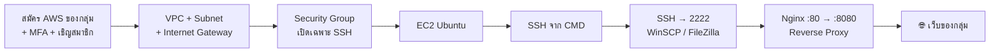

# ☁️ ICT24167 · AWS Cloud Network Lab

> **มหาวิทยาลัยศรีปทุม · คณะเทคโนโลยีสารสนเทศ**
> รายวิชา ICT24167 การบริหารเครือข่ายคอมพิวเตอร์ (Network Management)
> ผู้สอน: อาจารย์อำนาจ คงเจริญถิ่น · ภาคการศึกษาที่ 1/2569

ใน Packet Tracer เราสร้าง Router, Subnet และ ACL กันมาแล้ว ใน Lab ชุดนี้เราจะสร้างสิ่งเดียวกันบน **AWS** แล้วจบด้วย **เว็บไซต์ของกลุ่ม** ที่มีหน้าของสมาชิกทุกคน และใครก็เปิดดูได้จากอินเทอร์เน็ต

---

## 🗺️ เส้นทางการเรียน

| สัปดาห์ | Lab | สิ่งที่ได้ | เวลา |
|---|---|---|---|
| 1 | [**LAB 01 · Cloud Network & Secure Access**](lab01-aws-vpc-ec2-ssh.md) | บัญชี AWS ของกลุ่ม (New Experience, ไม่ใช้บัตร), VPC/Subnet ของตัวเอง, Security Group, EC2 และ SSH จาก Windows | 120 นาที |
| 2 | [**LAB 02 · Group Web App**](lab02-my-first-web-app.md) | เว็บของกลุ่ม (Homepage + หน้าสมาชิกแต่ละคน) บน Nginx แบบ Reverse Proxy (80 → 8080), ย้าย SSH ไปพอร์ต 2222 และอัปโหลดด้วย WinSCP / FileZilla | 120 นาที |

---

## 🔗 เชื่อมกับสิ่งที่เรียนมาแล้ว

| สิ่งที่เคยทำใน Packet Tracer / ตำรา | สิ่งที่ตรงกันใน AWS |
|---|---|
| ผังเครือข่ายทั้งหมดของบริษัท | **VPC** (Virtual Private Cloud) |
| แบ่งวง LAN / DMZ ด้วย Subnetting (Ch4-5) | **Subnet** (Public / Private) |
| Router + Default Route ออกอินเทอร์เน็ต | **Route Table** + **Internet Gateway** |
| Host Firewall แบบ Stateful (UFW, Ch11) | **Security Group** ผูกกับ Instance |
| Cisco ACL แบบ Stateless (Ch10) | **Network ACL** ผูกกับ Subnet |
| SSH เข้าเซิร์ฟเวอร์ (Ch8, Ch11) | SSH เข้า **EC2** ด้วย Key Pair |
| Nginx บน Ubuntu (Ch11) | Nginx บน EC2 ที่เปิดให้ทั้งโลกเข้าได้ |

---

## ✅ สิ่งที่ต้องเตรียม

- [ ] คอมพิวเตอร์ **Windows 10/11** (ใช้ CMD / PowerShell ที่มีอยู่แล้ว ไม่ต้องติดตั้งอะไรเพิ่ม)
- [ ] **จัดกลุ่ม** และเลือกหัวหน้ากลุ่ม (Owner) 1 คน · **1 กลุ่ม = อย่างน้อย 1 AWS Account**
- [ ] **อีเมล** `@spumail.com` หรือ `@gmail.com` ของ **ทุกคน** ในกลุ่ม (Owner ใช้สมัคร สมาชิกใช้รับคำเชิญเข้า Project)
- [ ] **โทรศัพท์มือถือ** ที่มีแอป Authenticator (Google Authenticator, Microsoft Authenticator ฯลฯ) สำหรับเปิด MFA
- [ ] (LAB 02) **WinSCP** หรือ **FileZilla** รุ่น *Portable* (ไฟล์ .zip ไม่ต้องติดตั้ง) ดาวน์โหลดจากเว็บทางการในคาบ ถ้าเครื่องเปิดไม่ได้ใช้ `scp` ใน CMD แทน
- [ ] **ไม่ต้องใช้บัตรเครดิต** · AWS แบบ *New Experience* (ก.ย. 2026) ให้ลูกค้าใหม่ส่วนใหญ่เริ่มที่ **Free plan** ได้โดยไม่ต้องกรอกบัตร

> [!CAUTION]
> ถ้าหน้าจอสมัครขอข้อมูลบัตร **ห้ามกรอก** ให้แจ้งผู้สอน และใช้บัญชีของสมาชิกคนอื่นในกลุ่มแทน

> [!NOTE]
> ใน New Experience ระบบ **กำหนด Region ให้อัตโนมัติ** (ห้องเรียนนี้ได้ **Sydney `ap-southeast-2`**) ถ้ากลุ่มได้ Region อื่น ให้ปรับชื่อ Availability Zone ตามที่ LAB 01 ข้อ 0.5 อธิบาย

---

## 🛡️ กติกาความปลอดภัย (อ่านก่อนเริ่ม)

> [!CAUTION]
> 1. **ห้าม** แชร์ หรือ commit ไฟล์ `.pem` / `.ppk` / Access Key ขึ้น GitHub หรือส่งในกลุ่มแชต
> 2. **ห้าม** แชร์รหัสผ่านในกลุ่ม ทุกคนเข้าระบบด้วยอีเมลของตัวเอง และ Owner ต้องเปิด MFA เสมอ
> 3. **ห้าม** กด Upgrade, Add payment method หรือ Activate Advanced Features ถ้าผู้สอนไม่ได้สั่ง
> 4. **Stop** Instance ทุกครั้งเมื่อจบคาบ และ **Terminate** เมื่อจบภาคเรียน
> 5. ภาพหน้าจอที่ส่งต้องไม่เห็นรหัสผ่าน, เลขบัตร หรือเนื้อหาของ Private Key
> 6. ทดสอบ / สแกนพอร์ตได้ **เฉพาะเครื่องของตัวเอง** เท่านั้น

> [!NOTE]
> หน้าจอ AWS Console เปลี่ยนบ่อย ชื่อปุ่มในเอกสารนี้อาจต่างจากที่เห็นเล็กน้อย ให้มองหาความหมายที่ใกล้เคียง หรือถามผู้สอน

---

## 📤 การส่งงาน (ส่งเป็นกลุ่ม)

แต่ละ Lab มีหัวข้อ **Evidence Pack** ท้ายเอกสาร ให้ **ตัวแทนกลุ่ม** รวมหลักฐานเป็น **PDF ไฟล์เดียว** แล้วส่งที่อีเมลอาจารย์ **6850018.st@spulive.net**

| Lab | ชื่อไฟล์ | หัวเรื่องอีเมล |
|---|---|---|
| LAB 01 | `ict24167_awslab1_ชื่อกลุ่ม.pdf` | `[ICT24167] AWS Lab 1 - ชื่อกลุ่ม` |
| LAB 02 | `ict24167_awslab2_ชื่อกลุ่ม.pdf` | `[ICT24167] AWS Lab 2 - ชื่อกลุ่ม` |

ตัวอย่างชื่อไฟล์: `ict24167_awslab1_cloudninja.pdf` (แนะนำตั้งชื่อกลุ่มเป็นภาษาอังกฤษตัวเล็ก ไม่มีช่องว่าง) · หน้าแรกของ PDF ต้องมีชื่อกลุ่มและตารางสมาชิก (รหัสนักศึกษา, ชื่อ-สกุล, หน้าที่)

---

อ้างอิง: [AWS reimagines the getting started experience (AWS News Blog, 2026)](https://aws.amazon.com/blogs/aws/aws-reimagines-the-getting-started-experience/) · ตำรา ICT24167 บทที่ 4-5 (Subnetting), 8 (Transport/Ports), 10 (Firewall), 11 (UFW และ Nginx) · [AWS Free Tier](https://aws.amazon.com/free/) · [Amazon VPC User Guide](https://docs.aws.amazon.com/vpc/latest/userguide/what-is-amazon-vpc.html) · [Amazon EC2 User Guide](https://docs.aws.amazon.com/AWSEC2/latest/UserGuide/concepts.html)
