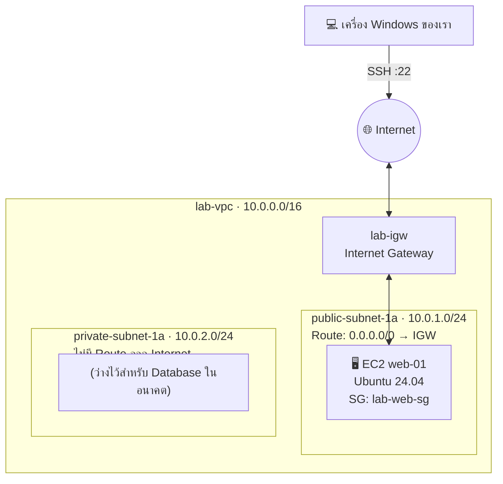

# LAB 01 · Cloud Network & Secure Access

> **ICT24167 Network Management** · สัปดาห์ที่ 1 ของชุด AWS · เวลา 120 นาที · ทำคนเดียว (นั่งคู่กับเพื่อนเพื่อช่วยกันตรวจได้)
> [← กลับหน้าหลัก](README.md) · [ไป LAB 02 →](lab02-my-first-web-app.md)

## 🎯 จบ Lab นี้แล้วทำอะไรได้

- [ ] สร้างบัญชี AWS ที่ **ปลอดภัยตั้งแต่วันแรก** (MFA + แจ้งเตือนค่าใช้จ่าย)
- [ ] ออกแบบและสร้าง **VPC / Subnet / Internet Gateway / Route Table** ด้วยมือ และอธิบายได้ว่าแต่ละชิ้นเทียบกับอุปกรณ์ใดใน Packet Tracer
- [ ] เขียนกฎ **Security Group** ให้เปิดเฉพาะที่จำเป็น และอธิบายว่าทำไมจึงเรียกว่า **Stateful**
- [ ] สร้าง **EC2** และ Remote เข้าไปด้วย **SSH จาก CMD** (และรู้ทางเลือก Instance Connect / PuTTY)
- [ ] ใช้ **Network ACL** พิสูจน์ความต่างของ **Stateless** กับ Stateful ด้วยตาตัวเอง

## ⏱️ แผนเวลา

| Part | หัวข้อ | เวลา |
|---|---|---|
| 0 | สมัคร AWS + MFA + Budget | 25 นาที |
| 1 | VPC, Subnet, Internet Gateway, Route Table | 25 นาที |
| 2 | Security Group | 10 นาที |
| 3 | สร้าง EC2 Instance | 15 นาที |
| 4 | Remote ด้วย SSH + Break & Fix | 25 นาที |
| 5 | Network ACL: Stateless vs Stateful | 15 นาที |
| 6 | เก็บงาน + Stop Instance | 5 นาที |

## 🧠 กติกา 2 ข้อในห้องนี้

1. **ทำนายก่อนทดสอบ** ทุกครั้งที่เห็นไอคอน 🔮 ให้เขียนคาดการณ์ลงใบบันทึกก่อนกด
2. **เปลี่ยนทีละอย่าง** แล้วทดสอบ (หลักเดียวกับ Ch13 การแก้ปัญหาเครือข่าย)

---

## Part 0 · สมัคร AWS Account (25 นาที)

### 0.1 สมัครบัญชี

1. เปิด <https://aws.amazon.com/free/> แล้วกด **Create a Free Account** (หรือ *Create an AWS Account*)
2. กรอก **Root user email address** และ **AWS account name** (เช่น `spu-รหัสนักศึกษา`) แล้วกด *Verify email address*
3. นำรหัสยืนยันจากอีเมลมากรอก
4. ตั้ง **Root password** ที่แข็งแรง (อย่างน้อย 12 ตัว ผสมตัวพิมพ์เล็ก-ใหญ่ ตัวเลข สัญลักษณ์) และ **ห้ามใช้ซ้ำกับบัญชีอื่น**
5. เลือก **Choose your account plan** → **Free plan**

   | Plan | ความหมาย |
   |---|---|
   | ✅ **Free plan** | ใช้เครดิตฟรี ไม่ถูกเรียกเก็บเงิน ใช้ได้ 6 เดือนหรือจนเครดิตหมด (เลือกอันนี้) |
   | Paid plan | ใช้ได้ทุกบริการ เมื่อเครดิตหมดจะถูกเรียกเก็บเงินจริง |

6. Contact information: เลือก **Personal** แล้วกรอกข้อมูลเป็นภาษาอังกฤษ
7. Billing information: กรอกบัตร (ระบบอาจตัดยอดทดสอบเล็กน้อยแล้วคืนให้)
8. Identity verification: เลือก **Text message (SMS)** แล้วกรอกรหัสที่ได้รับ
9. Support plan: เลือก **Basic support – Free** แล้วกด *Complete sign up*

> [!TIP]
> ถ้าหน้าจอค้างที่ "Account is being activated" ให้รอ 5-10 นาที แล้วลอง Sign in ใหม่ ไม่ต้องสมัครซ้ำ

### 0.2 เปิด MFA ให้ Root User (ห้ามข้าม)

1. Sign in ด้วย **Root user** ที่ <https://console.aws.amazon.com/>
2. คลิกชื่อบัญชีมุมขวาบน → **Security credentials**
3. หัวข้อ *Multi-factor authentication (MFA)* → **Assign MFA device**
4. ตั้งชื่ออุปกรณ์ (เช่น `my-phone`) → เลือก **Authenticator app** → *Next*
5. สแกน QR Code ด้วยแอป Authenticator แล้วกรอกรหัส **2 ชุดติดกัน** → *Add MFA*
6. Sign out แล้ว Sign in ใหม่ ระบบต้องถามรหัส MFA

> [!IMPORTANT]
> **ทำไมต้องทำ?** Root user ทำได้ทุกอย่าง รวมถึงปิดบัญชีและใช้เงินไม่จำกัด ถ้ารหัสผ่านหลุดโดยไม่มี MFA คนอื่นจะเข้าบัญชีได้ทันที ในบริษัทจริง ถ้าบัญชี Root ไม่มี MFA จะถูกตีเป็นข้อบกพร่องร้ายแรงตอน Audit

### 0.3 ตั้ง Budget แจ้งเตือนค่าใช้จ่าย

1. ช่องค้นหาด้านบนพิมพ์ **Budgets** → เปิด *Billing and Cost Management › Budgets*
2. **Create budget** → **Use a template (simplified)** → เลือก **Zero spend budget**
3. ใส่อีเมลของตัวเองในช่อง *Email recipients* → **Create budget**

### 0.4 เลือก Region

มุมขวาบนเลือก **Asia Pacific (Singapore) ap-southeast-1** และ **ใช้ Region นี้ตลอดทั้งชุด Lab**

> [!NOTE]
> AWS มี Region **Asia Pacific (Thailand) ap-southeast-7** แล้ว แต่เป็น Region แบบ *opt-in* ที่ต้องเปิดใช้งานก่อน ใน Lab นี้จึงใช้ Singapore เพื่อให้ทุกคนเหมือนกัน
> 🔮 **คิดต่อ:** ถ้าเป็นระบบของลูกค้าไทยจริง การเลือก Region มีผลต่ออะไรบ้าง? (Latency, กฎหมาย PDPA / Data Residency, ราคา)

> [!TIP]
> **Checkpoint 0** 📸 ถ่ายภาพหน้า *Security credentials* ที่เห็นว่ามี MFA device แล้ว และหน้า *Budgets* ที่มี Zero spend budget (หลักฐาน E1)

---

## Part 1 · VPC และ Subnet: สร้างเครือข่ายของเราเอง (25 นาที)

### 1.0 ภาพรวมสิ่งที่จะสร้าง



| ชิ้นส่วน AWS | ค่าที่ใช้ | เทียบกับใน Packet Tracer |
|---|---|---|
| VPC `lab-vpc` | `10.0.0.0/16` | ทั้งผังเครือข่ายของบริษัท |
| Subnet `public-subnet-1a` | `10.0.1.0/24` | วง DMZ (มีเว็บเซิร์ฟเวอร์) |
| Subnet `private-subnet-1a` | `10.0.2.0/24` | วง LAN ภายใน |
| Internet Gateway `lab-igw` | ผูกกับ `lab-vpc` | ขา WAN ของ Router ที่ต่อออก ISP |
| Route Table `public-rt` | `0.0.0.0/0 → lab-igw` | `ip route 0.0.0.0 0.0.0.0 ...` (Default Route) |

> [!NOTE]
> ทุกบัญชีมี **Default VPC** มาให้แล้ว แต่เราจะ **สร้างเองด้วยมือ** เพื่อให้เห็นทุกชิ้นส่วน (เหมือนต่อสายเองใน PT แทนการเปิดไฟล์สำเร็จรูป)

### 1.1 🔮 ทำนายก่อน: คำนวณ Subnet

| คำถาม | คำตอบของฉัน |
|---|---|
| `10.0.0.0/16` มี IP ทั้งหมดกี่ตัว | |
| `10.0.1.0/24` มี IP ทั้งหมดกี่ตัว | |
| ใน Subnet ปกติ (Ch5) ใช้งานได้จริงกี่ตัว | |
| ใน AWS ใช้ได้จริงกี่ตัว (ดูหลังสร้างเสร็จ ในคอลัมน์ *Available IPv4 addresses*) | |

<details>
<summary>💡 คำใบ้: ทำไม AWS ให้ใช้ได้น้อยกว่า</summary>

AWS จอง IP ไว้ **5 ตัวในทุก Subnet**: ตัวแรก (Network), .1 (VPC Router), .2 (DNS), .3 (สำรองให้ AWS) และตัวสุดท้าย (Broadcast) ลองคำนวณใหม่ดู

</details>

### 1.2 สร้าง VPC

1. ช่องค้นหาพิมพ์ **VPC** → เปิด *VPC Dashboard*
2. เมนูซ้าย **Your VPCs** → **Create VPC**
3. Resources to create: เลือก **VPC only** (ไม่ใช้ *VPC and more*)
4. Name tag: `lab-vpc`
5. IPv4 CIDR: `10.0.0.0/16` · IPv6: **No IPv6 CIDR block** · Tenancy: **Default**
6. **Create VPC**
7. เลือก `lab-vpc` → **Actions › Edit VPC settings** → ติ๊ก ✅ **Enable DNS hostnames** → *Save*

### 1.3 สร้าง Subnet 2 วง

1. เมนูซ้าย **Subnets** → **Create subnet**
2. VPC ID: เลือก `lab-vpc`
3. Subnet 1:
   - Name: `public-subnet-1a`
   - Availability Zone: `ap-southeast-1a`
   - IPv4 subnet CIDR block: `10.0.1.0/24`
4. กด **Add new subnet** สำหรับ Subnet 2:
   - Name: `private-subnet-1a`
   - Availability Zone: `ap-southeast-1a`
   - IPv4 subnet CIDR block: `10.0.2.0/24`
5. **Create subnet**
6. เลือก `public-subnet-1a` → **Actions › Edit subnet settings** → ติ๊ก ✅ **Enable auto-assign public IPv4 address** → *Save*

### 1.4 สร้าง Internet Gateway และผูกกับ VPC

1. เมนูซ้าย **Internet gateways** → **Create internet gateway**
2. Name: `lab-igw` → **Create**
3. **Actions › Attach to VPC** → เลือก `lab-vpc` → **Attach internet gateway**

### 1.5 สร้าง Route Table สำหรับ Public Subnet

1. เมนูซ้าย **Route tables** → **Create route table**
2. Name: `public-rt` · VPC: `lab-vpc` → **Create**
3. แท็บ **Routes** → **Edit routes** → **Add route**
   - Destination: `0.0.0.0/0`
   - Target: **Internet Gateway** → `lab-igw`
   - **Save changes**
4. แท็บ **Subnet associations** → **Edit subnet associations** → ติ๊ก `public-subnet-1a` → **Save**

> [!IMPORTANT]
> **"Public" ไม่ได้มาจากชื่อ** Subnet จะเป็น Public ก็ต่อเมื่อ Route Table ของมันมีเส้นทาง `0.0.0.0/0` ไปที่ Internet Gateway เท่านั้น ส่วน `private-subnet-1a` ยังใช้ *Main route table* ที่มีแค่เส้นทาง `local` จึงออกอินเทอร์เน็ตไม่ได้

### 1.6 ตรวจทาน

| ตรวจ | ผลที่ต้องเห็น | ✅ |
|---|---|---|
| `public-rt` › Routes | `10.0.0.0/16 → local` และ `0.0.0.0/0 → igw-xxxx` | |
| `public-rt` › Subnet associations | มี `public-subnet-1a` | |
| `lab-igw` › State | **Attached** | |
| Subnets › `public-subnet-1a` | Auto-assign public IPv4 = **Yes** | |

> [!TIP]
> **Checkpoint 1** 📸 ภาพ *Resource map* ของ `lab-vpc` (เลือก VPC แล้วดูแท็บ **Resource map**) ซึ่งต้องเห็น Subnet 2 วง, Route Table และ IGW เชื่อมกัน (หลักฐาน E2)

---

## Part 2 · Security Group: ไฟร์วอลล์ประจำเครื่อง (10 นาที)

### 2.0 Security Group คืออะไร

| คุณสมบัติ | Security Group | เทียบกับที่เคยเรียน |
|---|---|---|
| ผูกกับอะไร | Network Interface ของ **Instance** | Host Firewall / UFW (Ch11) |
| ประเภทกฎ | **Allow อย่างเดียว** (ไม่มี Deny) | — |
| ค่าเริ่มต้น | Inbound: ปิดหมด · Outbound: เปิดหมด | `ufw default deny incoming` / `allow outgoing` |
| ขากลับ | **อนุญาตอัตโนมัติ (Stateful)** | UFW ที่จำสถานะการเชื่อมต่อ |
| ลำดับกฎ | ไม่มีลำดับ ประเมินทุกกฎรวมกัน | ต่างจาก ACL ที่ใช้กฎแรกที่ตรง (First-match) |

### 2.1 สร้าง Security Group

1. ช่องค้นหาพิมพ์ **EC2** → เมนูซ้าย **Network & Security › Security Groups** → **Create security group**
2. Security group name: `lab-web-sg`
3. Description: `Allow SSH from my IP only`
4. VPC: เลือก **`lab-vpc`** (⚠️ ระวังอย่าเลือก Default VPC)
5. **Inbound rules** → **Add rule**:

   | Type | Protocol | Port | Source | Description |
   |---|---|---|---|---|
   | SSH | TCP | 22 | **My IP** | `ssh from classroom` |

6. **Outbound rules**: คงค่าเดิม (All traffic → `0.0.0.0/0`)
7. **Create security group**

> [!NOTE]
> **My IP** คือ Public IP ที่ AWS มองเห็น ซึ่งเป็น IP ของ **Router ของมหาวิทยาลัย** (ผ่าน NAT ตาม Ch7) ไม่ใช่ IP `192.168.x.x` ของเครื่องเรา ทุกคนในห้องจึงอาจได้ IP เดียวกัน
> ถ้ากลับไปทำที่บ้าน IP จะเปลี่ยน และต้องกลับมาแก้กฎนี้ (เป็นสาเหตุอันดับ 1 ที่ทำให้ SSH จากบ้านไม่ได้)

### 2.2 🔮 ทำนาย (ยังไม่ต้องทดสอบ)

| # | สถานการณ์ (หลังสร้าง EC2 แล้ว) | ทำนาย: ได้ / ไม่ได้ + เหตุผล |
|---|---|---|
| P1 | SSH จากเครื่องในห้อง Lab | |
| P2 | `ping` Public IP ของ EC2 จากเครื่องในห้อง | |
| P3 | เปิด `http://<Public IP>` ในเบราว์เซอร์ | |
| P4 | ใน EC2 สั่ง `sudo apt update` (ออกอินเทอร์เน็ต) ทั้งที่ Outbound ไม่มีกฎสำหรับ "ขากลับ" | |

---

## Part 3 · สร้าง EC2 Instance (15 นาที)

1. EC2 Dashboard → **Instances** → **Launch instances**
2. **Name**: `web-01`
3. **Application and OS Images**: **Ubuntu** → **Ubuntu Server 24.04 LTS** (ต้องมีป้าย *Free tier eligible*)
4. **Instance type**: เลือกตัวที่มีป้าย **Free tier eligible** (เช่น `t3.micro`)
5. **Key pair (login)** → **Create new key pair**
   - Key pair name: `lab-key`
   - Key pair type: **RSA**
   - Private key file format: **`.pem`** (สำหรับ CMD/OpenSSH)
   - **Create key pair** → ไฟล์ `lab-key.pem` จะถูกดาวน์โหลด
   - ⚠️ ดาวน์โหลดได้ **ครั้งเดียวเท่านั้น** ถ้าหายต้องสร้าง Key ใหม่ ให้เก็บไว้ใน USB หรือ Cloud Drive ส่วนตัวด้วย (เครื่องในห้อง Lab อาจล้างไฟล์เมื่อ Restart) และ **ห้ามอัปโหลดขึ้น GitHub**

6. **Network settings** → กด **Edit**
   - VPC: **`lab-vpc`**
   - Subnet: **`public-subnet-1a`**
   - Auto-assign public IP: **Enable**
   - Firewall (security groups): **Select existing security group** → `lab-web-sg`
7. **Configure storage**: ใช้ค่าเริ่มต้น (gp3 8 GiB)
8. **Launch instance** → **View all instances**
9. รอให้ *Instance state* = **Running** และ *Status check* = **3/3 checks passed** (ประมาณ 1-2 นาที)
10. คลิก `web-01` แล้วจดค่าลงตาราง:

| รายการ | ค่า |
|---|---|
| Instance ID | `i-...` |
| Public IPv4 address | |
| Private IPv4 address | `10.0.1.___` |
| Availability Zone | |

> 🔮 **คิดต่อ:** Private IP อยู่ในวงไหน ตรงกับ Subnet ที่เราออกแบบไว้หรือไม่ แล้วเลขตัวสุดท้ายเริ่มที่ .4 ขึ้นไปเพราะอะไร (ย้อนดู 1.1)

> [!TIP]
> **Checkpoint 3** 📸 ภาพหน้า Instance summary ที่เห็น Running, Public IP, Private IP, VPC และ Subnet (หลักฐาน E3)

---

## Part 4 · Remote เข้า EC2 (25 นาที)

### 4.1 วิธีหลัก: SSH ผ่าน CMD / PowerShell (มีใน Windows อยู่แล้ว)

**ขั้นที่ 1 · ตรวจว่ามีคำสั่ง ssh**

```cmd
ssh -V
```

ต้องเห็นเวอร์ชัน เช่น `OpenSSH_for_Windows_9.x`

**ขั้นที่ 2 · ย้ายไปโฟลเดอร์ที่เก็บ Key**

```cmd
cd %USERPROFILE%\Downloads
dir lab-key.pem
```

**ขั้นที่ 3 · ล็อกสิทธิ์ไฟล์ Key ให้เจ้าของอ่านได้คนเดียว**

```cmd
icacls lab-key.pem /inheritance:r
icacls lab-key.pem /grant:r "%USERNAME%:R"
```

> [!NOTE]
> OpenSSH จะ **ปฏิเสธ Key ที่คนอื่นอ่านได้** และขึ้นข้อความ `WARNING: UNPROTECTED PRIVATE KEY FILE!` ขั้นนี้จึงเทียบได้กับ `chmod 400 lab-key.pem` บน Linux/Mac

**ขั้นที่ 4 · เชื่อมต่อ** (เปลี่ยน `13.x.x.x` เป็น Public IP ของตัวเอง)

```cmd
ssh -i lab-key.pem ubuntu@13.x.x.x
```

ครั้งแรกจะถามยืนยัน Fingerprint ให้พิมพ์ `yes`

```text
The authenticity of host '13.x.x.x (13.x.x.x)' can't be established.
ED25519 key fingerprint is SHA256:xxxxxxxxxxxxxxxxxxxx.
Are you sure you want to continue connecting (yes/no/[fingerprint])? yes
```

เมื่อสำเร็จจะเห็น Prompt แบบนี้:

```text
ubuntu@ip-10-0-1-xx:~$
```

> 🔮 สังเกต: ชื่อเครื่อง `ip-10-0-1-xx` คือ IP ใด, Public หรือ Private? เครื่อง EC2 เองรู้จัก Public IP ของตัวเองหรือไม่?

**ขั้นที่ 5 · สำรวจเครื่องจากด้านใน**

```bash
hostname -I            # IP ที่การ์ดเครือข่ายเห็น (มีแต่ Private IP)
ip route               # Default Gateway คือ 10.0.1.1 (VPC Router)
cat /etc/resolv.conf   # DNS ของ VPC
curl -s ifconfig.me    # Public IP ที่โลกภายนอกเห็น
sudo apt update        # ทดสอบออกอินเทอร์เน็ต (ข้อ P4)
```

| คำสั่ง | ผลที่ได้ | ความหมาย |
|---|---|---|
| `hostname -I` | | |
| `ip route` (default via ...) | | |
| `curl -s ifconfig.me` | | |
| `sudo apt update` สำเร็จหรือไม่ | | |

> [!IMPORTANT]
> **Public IP ไม่ได้อยู่บนการ์ดเครือข่ายของ EC2** แต่ Internet Gateway ทำ **1:1 NAT** แปลงให้ (แนวคิดเดียวกับ Static NAT ใน Ch7)

### 4.2 กลับไปเติมผลจริงในตารางทำนาย (Part 2.2)

| # | ทำนาย | ผลจริง | ตรงไหม | อธิบาย |
|---|---|---|---|---|
| P1 SSH | | | | |
| P2 ping | | | | |
| P3 http | | | | |
| P4 apt update | | | | |

<details>
<summary>💡 คำใบ้ P2 และ P4</summary>

- **P2:** `ping` ใช้โปรโตคอล ICMP ซึ่งไม่ใช่ TCP 22 แล้วเรามีกฎ Inbound สำหรับ ICMP หรือยัง?
- **P4:** Security Group "จำ" ได้ว่า EC2 เป็นฝ่ายเริ่มการเชื่อมต่อออกไป แพ็กเก็ตตอบกลับจึงผ่านเข้ามาได้เอง นี่แหละความหมายของ **Stateful**

</details>

### 4.3 💥 Break & Fix: SSH ไม่ได้

**1) Break**: ไปที่ Security Group `lab-web-sg` → **Edit inbound rules** → **ลบ** กฎ SSH → *Save*

**2) Observe**: พิมพ์ `exit` เพื่อออก แล้วสั่ง SSH ใหม่ พร้อมวัดผลด้วย PowerShell

```powershell
ssh -i lab-key.pem ubuntu@13.x.x.x
Test-NetConnection 13.x.x.x -Port 22
```

| สิ่งที่เห็น | บันทึก |
|---|---|
| ข้อความ Error ของ ssh | |
| ใช้เวลาประมาณกี่วินาทีจึงขึ้น Error | |
| `TcpTestSucceeded` | |

**3) Isolate**: ตอบคำถาม

- Error คือ `Connection timed out` หรือ `Connection refused`? แต่ละแบบบอกอะไร (ย้อนดู Ch11 หัวข้อ 11.5 เรื่อง *filtered* กับ *closed*)
- ปัญหาอยู่ที่ **เครื่อง EC2** หรือ **ไฟร์วอลล์**? รู้ได้อย่างไร?

**4) Fix**: เพิ่มกฎ SSH / TCP 22 / **My IP** กลับเข้าไป แล้ว SSH ใหม่ให้สำเร็จ

> [!TIP]
> **Checkpoint 4** 📸 (ก) หน้าจอ SSH ที่เห็น `ubuntu@ip-10-0-1-xx` พร้อมผล `hostname -I` และ `curl ifconfig.me` (ข) ผล `Test-NetConnection` ตอน Break (หลักฐาน E4, E5)

### 4.4 ทางเลือก A: EC2 Instance Connect (ผ่านเบราว์เซอร์)

ใช้เมื่อเครือข่ายบล็อกพอร์ต 22 หรือไม่มีไฟล์ Key อยู่กับตัว

1. Instances → เลือก `web-01` → **Connect** → แท็บ **EC2 Instance Connect** → Username: `ubuntu` → **Connect**
2. 🔮 **คาดว่าจะเชื่อมต่อได้หรือไม่?** ลองแล้วบันทึกผล

<details>
<summary>💡 ทำไมจึงเชื่อมต่อไม่ได้ และแก้อย่างไร</summary>

การเชื่อมต่อนี้ **ไม่ได้มาจาก IP ของเรา** แต่มาจากเครื่องของบริการ EC2 Instance Connect ใน Region นั้น ซึ่งกฎ "My IP" ไม่ครอบคลุม
แก้โดยเพิ่ม Inbound rule: Type **SSH** · Source เลือก **Prefix list** → `com.amazonaws.ap-southeast-1.ec2-instance-connect`
บทเรียน: ต้องรู้เสมอว่า **ใครเป็นต้นทางจริง** ของการเชื่อมต่อ ก่อนเขียนกฎไฟร์วอลล์

</details>

### 4.5 ทางเลือก B: PuTTY (สำหรับทำที่บ้าน)

> [!NOTE]
> เครื่องในห้อง Lab ติดตั้งโปรแกรมไม่ได้ ส่วนนี้จึงให้ไปลองทำเองที่บ้าน

1. ดาวน์โหลด PuTTY จาก <https://www.chiark.greenend.org.uk/~sgtatham/putty/> (เว็บทางการเท่านั้น)
2. เปิด **PuTTYgen** → *Load* `lab-key.pem` → **Save private key** เป็น `lab-key.ppk`
3. เปิด **PuTTY**
   - Session › Host Name: `ubuntu@13.x.x.x` · Port: `22`
   - Connection › SSH › Auth › **Credentials** › Private key file: เลือก `lab-key.ppk`
   - กลับไป Session ตั้งชื่อ `aws-web-01` แล้วกด *Save* → **Open**

### 4.6 เปรียบเทียบ 3 วิธี

| วิธี | ต้องติดตั้ง | ต้องมี Key | ต้องเปิด SG ให้ใคร | เหมาะกับ |
|---|---|---|---|---|
| `ssh` ใน CMD | ไม่ต้อง | ✅ `.pem` | My IP | งานประจำ, Script, ห้อง Lab นี้ |
| EC2 Instance Connect | ไม่ต้อง | ไม่ต้อง | Prefix list ของ AWS | ฉุกเฉิน, เครือข่ายบล็อกพอร์ต 22 |
| PuTTY | ต้อง | ✅ `.ppk` | My IP | ผู้ที่ชินกับ GUI บน Windows |

---

## Part 5 · Network ACL: Stateless vs Stateful (15 นาที)

### 5.0 เทียบให้ชัด

| | Security Group | Network ACL |
|---|---|---|
| ผูกกับ | Instance | **Subnet** |
| กฎ | Allow อย่างเดียว | **Allow และ Deny** |
| ลำดับ | ประเมินทุกกฎรวมกัน | **เรียงตามเลขกฎ น้อยไปมาก หยุดที่กฎแรกที่ตรง** (เหมือน Cisco ACL) |
| ขากลับ | อนุญาตอัตโนมัติ (**Stateful**) | **ต้องเขียนกฎเอง (Stateless)** |

### 5.1 สร้าง NACL ใหม่และผูกกับ Public Subnet

1. VPC Dashboard → **Network ACLs** → **Create network ACL**
2. Name: `lab-public-nacl` · VPC: `lab-vpc` → **Create**
3. เลือก `lab-public-nacl` → แท็บ **Subnet associations** → **Edit** → ติ๊ก `public-subnet-1a` → *Save*

> 🔮 NACL ที่สร้างใหม่ **ไม่มีกฎ Allow เลย** (มีแค่ `*  DENY` ทั้งขาเข้าและขาออก) ตอนนี้ SSH จะเป็นอย่างไร?

### 5.2 เปิดขาเข้าอย่างเดียว

แท็บ **Inbound rules** → **Edit inbound rules** → **Add new rule**

| Rule number | Type | Port | Source | Allow/Deny |
|---|---|---|---|---|
| 100 | SSH (22) | 22 | `0.0.0.0/0` | **Allow** |

**Save** แล้วลอง SSH ใหม่

> 🔮 **ทำนาย:** SSH จะได้หรือไม่ เพราะอะไร? ________________

### 5.3 สืบและแก้

<details>
<summary>💡 คำใบ้ (เปิดหลังลองแล้วเท่านั้น)</summary>

แพ็กเก็ตขาเข้าไปถึง EC2 ได้แล้ว แต่ **คำตอบกลับ** จาก EC2 ออกจาก Subnet ไปที่ **พอร์ตต้นทางของเครื่องเรา** ซึ่งเป็นเลขสูงที่ระบบสุ่ม (Ephemeral port, Ch8) แล้ว Outbound rules ของ NACL ตอนนี้อนุญาตอะไรบ้าง?

</details>

แก้โดยเพิ่ม **Outbound rules**:

| Rule number | Type | Port range | Destination | Allow/Deny |
|---|---|---|---|---|
| 100 | Custom TCP | `1024-65535` | `0.0.0.0/0` | **Allow** |

ทดสอบ SSH ใหม่ ต้องเข้าได้แล้ว

> [!IMPORTANT]
> นี่คือบทเรียนเดียวกับ `established` ใน Cisco ACL (Lab Firewall Part A) **ไฟร์วอลล์แบบ Stateless ไม่รู้ว่าแพ็กเก็ตไหนคือคำตอบ เราจึงต้องเปิดทางกลับเอง** ส่วน Security Group ไม่ต้องทำ

### 5.4 ลำดับกฎสำคัญ

เพิ่ม Inbound rule อีกบรรทัด แล้วใส่ Public IP ของห้อง (ดูจาก <https://checkip.amazonaws.com>) ลงใน Source:

| Rule number | Type | Port | Source | Allow/Deny |
|---|---|---|---|---|
| **90** | SSH (22) | 22 | `<IP ของห้อง>/32` | **Deny** |
| 100 | SSH (22) | 22 | `0.0.0.0/0` | Allow |

> 🔮 SSH ได้หรือไม่? ถ้าเปลี่ยนเลข 90 เป็น 110 ผลจะเปลี่ยนไหม? ลองทั้งสองแบบแล้วบันทึกผล

| Deny ใช้เลขกฎ | ผล SSH | เหตุผล |
|---|---|---|
| 90 | | |
| 110 | | |

### 5.5 คืนค่าเดิม (สำคัญมากสำหรับ LAB 02)

1. **Network ACLs** → เลือก NACL ที่มี *Default = Yes* ของ `lab-vpc`
2. แท็บ **Subnet associations** → **Edit** → ติ๊ก `public-subnet-1a` → *Save* (ย้าย Subnet กลับไปใช้ NACL เริ่มต้นที่อนุญาตทั้งหมด)
3. ลบ `lab-public-nacl` ได้

> [!TIP]
> **Checkpoint 5** 📸 ภาพ Inbound/Outbound rules ของ `lab-public-nacl` ขณะ SSH ได้ และตารางผลข้อ 5.4 (หลักฐาน E6)

---

## Part 6 · เก็บงาน (5 นาที)

1. ใน SSH พิมพ์ `exit`
2. EC2 → Instances → เลือก `web-01` → **Instance state › Stop instance**

> [!WARNING]
> **Stop ไม่ใช่ Terminate** สัปดาห์หน้าเราจะใช้เครื่องนี้ต่อ
> 🔮 หลัง Start ใหม่ **Public IP จะเปลี่ยน** ลองคิดว่าทำไม และถ้าเป็นเว็บจริงของบริษัทจะแก้ปัญหานี้ด้วยอะไร (คำใบ้: Elastic IP + DNS)

> [!NOTE]
> **เครดิตกับค่าใช้จ่าย:** ขณะ Instance ทำงาน AWS คิดค่า EC2 และค่า **Public IPv4** เป็นรายชั่วโมง ซึ่ง Free plan หักจากเครดิต ส่วน Instance ที่ Stop แล้วยังคิดค่า **EBS Storage** อยู่เล็กน้อย จึงต้องตรวจหน้า **Billing › Credits** ทุกสัปดาห์

---

## 🧾 สรุปคำสั่งที่ใช้

| งาน | คำสั่ง (Windows CMD) |
|---|---|
| ตรวจ OpenSSH | `ssh -V` |
| ล็อกสิทธิ์ Key | `icacls lab-key.pem /inheritance:r` และ `icacls lab-key.pem /grant:r "%USERNAME%:R"` |
| SSH | `ssh -i lab-key.pem ubuntu@<Public IP>` |
| ทดสอบพอร์ต (PowerShell) | `Test-NetConnection <Public IP> -Port 22` |
| ดู Public IP ของห้อง | เปิด `https://checkip.amazonaws.com` |

## 🆘 แก้ปัญหาเร็ว

| อาการ | ตรวจอะไรก่อน |
|---|---|
| `Connection timed out` | SG ไม่มีกฎ 22 จาก IP ของเรา · My IP เปลี่ยน · NACL ไม่เปิดขาออก 1024-65535 · Subnet ไม่มี Route ไป IGW · Instance ไม่มี Public IP |
| `Permission denied (publickey)` | Username ผิด (Ubuntu ใช้ `ubuntu`) · ใช้ Key ผิดไฟล์ · Instance สร้างด้วย Key อื่น |
| `UNPROTECTED PRIVATE KEY FILE` | ทำขั้น `icacls` ใน 4.1 ขั้นที่ 3 |
| `Identity file not accessible` | ไม่ได้อยู่ในโฟลเดอร์ที่มีไฟล์ Key · พิมพ์ชื่อไฟล์ผิด |
| เลือก `lab-vpc` ใน EC2 ไม่ได้ / SG ไม่ขึ้น | SG ถูกสร้างใน Default VPC ให้สร้างใหม่ใน `lab-vpc` |
| เครือข่ายมหาวิทยาลัยบล็อกพอร์ต 22 | ใช้ EC2 Instance Connect (4.4) |

---

## 📦 Evidence Pack (100 คะแนน)

| รหัส | หลักฐาน | คะแนน |
|---|---|---|
| E1 | MFA ของ Root + Zero spend budget | 10 |
| E2 | Resource map ของ `lab-vpc` + ตารางคำนวณ Subnet 1.1 (ผลจริงจากคอลัมน์ *Available IPv4*) | 15 |
| E3 | Instance summary (Running, Public/Private IP, VPC, Subnet) | 10 |
| E4 | SSH สำเร็จ + ตารางสำรวจ 4.1 ขั้นที่ 5 + ตารางทำนาย P1-P4 พร้อมเหตุผล | 20 |
| E5 | Break & Fix: ข้อความ Error, `Test-NetConnection` และคำตอบ timed out กับ refused | 15 |
| E6 | NACL: กฎขาออก 1024-65535 + ตารางลำดับกฎ 90/110 | 15 |
| E7 | สะท้อนคิด (ด้านล่าง) | 15 |

### ✍️ สะท้อนคิด (E7)

1. อธิบายด้วยคำพูดของตัวเองว่า **Stateful** กับ **Stateless** ต่างกันอย่างไร โดยยกหลักฐานจาก Lab นี้อย่างน้อย 1 อย่าง
2. ถ้าลูกค้าบอกว่า "ขอเปิดพอร์ต 22 ให้ `0.0.0.0/0` ไปเลย จะได้ไม่ต้องแก้กฎบ่อย" จะอธิบายความเสี่ยงและเสนอทางเลือกที่ดีกว่าอย่างไร (3-4 บรรทัด)
3. Public IP ของ EC2 ไม่ได้อยู่บนการ์ดเครือข่ายของเครื่อง แล้วอยู่ที่ไหน? เชื่อมกับเรื่อง NAT ในบทที่ 7

---

[← กลับหน้าหลัก](README.md) · [ไป LAB 02: My First Web App →](lab02-my-first-web-app.md)
