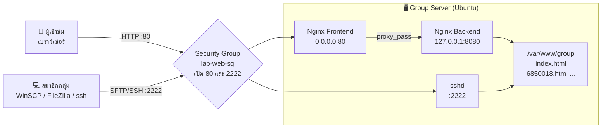
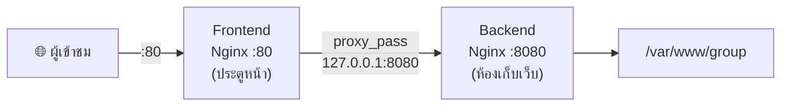

# LAB 02 · Group Web App 🌐

> **ICT24167 Network Management** · สัปดาห์ที่ 2 ของชุด AWS · เวลา 120 นาที · **ทำเป็นกลุ่ม** (บัญชี AWS เดียวกับ LAB 01)
> [← LAB 01](lab01-aws-vpc-ec2-ssh.md) · [กลับหน้าหลัก](README.md)

> [!IMPORTANT]
> **ต้องทำ LAB 01 เสร็จก่อน** ทุกคนต้องมีไฟล์ Key ของตัวเอง (`key-<ชื่อเล่น>.pem`) ที่ใช้ SSH ได้แล้ว และกลุ่มต้องมี `lab-vpc` กับ `lab-web-sg`
> ในเอกสารนี้ใช้ค่าตัวอย่างต่อไปนี้ **ให้แทนด้วยค่าจริงของตัวเองทุกครั้ง**
>
> | ตัวอย่างในเอกสาร | แทนด้วย |
> |---|---|
> | `13.x.x.x` | Public IP ของเครื่อง Group Server |
> | `key-oil.pem` | ไฟล์ Key ของตัวเอง |
> | `6850018` | รหัสนักศึกษาของตัวเอง |

## 🎯 จบ Lab นี้แล้วทำอะไรได้

- [ ] ทำเว็บของกลุ่ม: **หน้าแรก (`index.html`)** ที่ลิงก์ไปหน้าของสมาชิกแต่ละคน (**`รหัสนักศึกษา.html`**)
- [ ] ย้าย SSH จากพอร์ต **22 → 2222** อย่างปลอดภัย และตั้งกฎ **Security Group** ให้ตรงกัน
- [ ] ให้เพื่อนในกลุ่มเข้าเครื่องได้ด้วย **Public Key ของแต่ละคน** โดยไม่แชร์ Private Key
- [ ] ตั้ง **Nginx Reverse Proxy**: รับผู้ใช้ที่พอร์ต **80** แล้วส่งต่อไปที่ Backend พอร์ต **8080**
- [ ] อัปโหลดไฟล์ขึ้นเซิร์ฟเวอร์ด้วย **WinSCP** หรือ **FileZilla** (SFTP)
- [ ] แยกอาการ **closed / filtered / 502 Bad Gateway** ได้จากการทดลองจริง

## ⏱️ แผนเวลา

| Part | หัวข้อ | ใครทำ | เวลา |
|---|---|---|---|
| 0 | เตรียม Group Server | Owner | 10 นาที |
| 1 | ออกแบบเว็บของกลุ่มด้วย AI | **ทุกคน** (ทำคู่ขนานกับ Part 2-4 ได้) | 20 นาที |
| 2 | ย้าย SSH ไปพอร์ต 2222 | Driver + ทั้งกลุ่มดู | 15 นาที |
| 3 | ให้สมาชิกเข้าเครื่องด้วย Key ของตัวเอง | ทุกคน | 10 นาที |
| 4 | Nginx Reverse Proxy 80 → 8080 | Driver | 20 นาที |
| 5 | อัปโหลดด้วย WinSCP / FileZilla | **ทุกคน** | 15 นาที |
| 6 | ทดสอบ + อ่าน Log | ทุกคน | 10 นาที |
| 7 | Break & Fix | ทั้งกลุ่ม | 15 นาที |
| 8 | สรุป + เก็บงาน + ส่งงาน | ทั้งกลุ่ม | 5 นาที |

## 🗺️ ภาพรวมสิ่งที่จะสร้าง



| URL | แสดงหน้าอะไร |
|---|---|
| `http://13.x.x.x/` | หน้าแรกของกลุ่ม (`index.html`) |
| `http://13.x.x.x/6850018.html` | หน้าของสมาชิกรหัส 6850018 |

---

## Part 0 · เตรียม Group Server (10 นาที · Owner)

กลุ่มจะใช้ **EC2 ของ Owner เพียงเครื่องเดียว** เป็นเว็บเซิร์ฟเวอร์ของกลุ่ม (เรียกว่า **Group Server**)

1. Owner เข้า AWS → **EC2 › Instances** → เลือก `web-<ชื่อเล่น Owner>` → **Instance state › Start instance**
2. สมาชิกคนอื่น **ปล่อยเครื่องของตัวเองให้ Stop ไว้** (ประหยัดเครดิตของกลุ่ม)
3. รอจนขึ้น **Running** และ **3/3 checks passed** แล้วจด Public IP ใหม่ลงตาราง (IP เปลี่ยนทุกครั้งที่ Stop/Start)

   | รายการ | ค่า |
   |---|---|
   | Instance ที่ใช้เป็น Group Server | `web-` |
   | Public IPv4 | |

4. ตรวจ **Security Group `lab-web-sg` › Inbound rules** ต้องมีกฎ **SSH · TCP 22 · My IP** (ถ้า IP ของห้องเปลี่ยน ให้กด Edit แล้วเลือก My IP ใหม่)
5. ตรวจ **VPC › Subnets › `public-subnet-1a` › Network ACL** ต้องเป็น NACL ที่ **Default = Yes** (คืนค่าไว้แล้วใน LAB 01 ข้อ 5.5)
6. Owner เปิด CMD ในโฟลเดอร์ที่มี Key แล้ว SSH เข้าเครื่อง

   ```cmd
   cd %USERPROFILE%\Downloads
   ssh -i key-oil.pem ubuntu@13.x.x.x
   ```

> [!WARNING]
> หน้าต่าง SSH นี้คือ **Session หลัก ห้ามปิดจนกว่าจะจบ Part 3** ถ้าตั้งค่า SSH ผิด นี่คือทางเดียวที่จะกลับเข้าไปแก้ได้

---

## Part 1 · ออกแบบเว็บของกลุ่มด้วย AI (20 นาที · ทุกคน)

> [!TIP]
> ระหว่างที่ Driver ทำ Part 2-4 บนเซิร์ฟเวอร์ สมาชิกคนอื่นทำ Part 1 ไปพร้อมกันได้เลย

### 1.1 กติกาความเป็นส่วนตัว (PDPA)

เว็บนี้เป็น **สาธารณะ** ทั้งโลกเปิดดูได้ และ Bot จะเก็บข้อมูลไป

| ✅ ใส่ได้ | ❌ ห้ามใส่ |
|---|---|
| ชื่อเล่น หรือชื่อจริง (ตามความสมัครใจ) | เลขบัตรประชาชน, เบอร์โทร, ที่อยู่บ้าน |
| รหัสนักศึกษา (ใช้เป็นชื่อไฟล์ตามที่อาจารย์กำหนด) | วันเดือนปีเกิดเต็ม |
| สาขา, ทักษะ, งานอดิเรก, โปรเจกต์ | อีเมลส่วนตัวหลัก (ใช้อีเมลมหาวิทยาลัย หรือไม่ใส่เลย) |
| ลิงก์ GitHub / LinkedIn, รูป Avatar / การ์ตูน | รูปถ่ายบัตร, รูปที่ระบุตำแหน่งบ้าน |

### 1.2 ตกลง Design Brief ของกลุ่ม (ทุกคนใช้ค่าเดียวกัน)

เพื่อให้ทุกหน้าดูเป็นเว็บเดียวกัน ให้กลุ่มตกลงค่าต่อไปนี้แล้วส่งให้ทุกคนในกลุ่มแชต

| รายการ | ค่าของกลุ่ม (ตัวอย่าง) |
|---|---|
| ชื่อกลุ่ม | `Cloud Ninja` |
| สโลแกน | `เรียน Cloud แบบลงมือจริง` |
| สีหลัก / สีรอง (HEX) | `#0EA5E9` / `#0F172A` |
| ฟอนต์ (Google Fonts) | `Kanit` |
| สไตล์ | มินิมอล โทนมืด |
| สมาชิก | `6850018 – ออย`, `6850019 – บีม`, ... |

### 1.3 Prompt A: หน้าแรกของกลุ่ม (`index.html` · ทำ 1 คน)

```text
ช่วยเขียนหน้าแรกของเว็บไซต์กลุ่มให้หน่อย

ข้อกำหนดทางเทคนิค:
- ไฟล์เดียวชื่อ index.html มี HTML + CSS ในไฟล์ (ไม่มีไฟล์แยก ไม่ใช้ JavaScript framework)
- โหลดจากภายนอกได้เฉพาะ Google Fonts
- ใส่ <meta charset="UTF-8"> และ <meta name="viewport" content="width=device-width, initial-scale=1"> และรองรับมือถือ
- ใส่ comment ภาษาไทยสั้น ๆ อธิบายแต่ละส่วน

Design brief:
- ชื่อกลุ่ม: (ชื่อกลุ่ม) · สโลแกน: (สโลแกน)
- สีหลัก (HEX) · สีรอง (HEX) · ฟอนต์ Google Fonts: (ชื่อฟอนต์) · สไตล์: (สไตล์)

เนื้อหา:
- ส่วนหัว: ชื่อกลุ่ม + สโลแกน
- ส่วน "เกี่ยวกับกลุ่ม" 2-3 ประโยค: (เขียนเอง)
- ส่วน "สมาชิก" เป็นการ์ด 1 ใบต่อคน แสดงชื่อเล่นและรหัสนักศึกษา
  แต่ละการ์ดลิงก์ไปที่ไฟล์ชื่อ "รหัสนักศึกษา.html" แบบ relative link เช่น <a href="6850018.html">
  รายชื่อ: (6850018 – ชื่อเล่น), (6850019 – ชื่อเล่น), ...
- ท้ายหน้าเขียนว่า "Hosted on AWS EC2 · Nginx Reverse Proxy · ICT24167"
```

### 1.4 Prompt B: หน้าของสมาชิก (`รหัสนักศึกษา.html` · ทุกคนทำของตัวเอง)

```text
ช่วยเขียนหน้าเว็บประวัติส่วนตัวแบบหน้าเดียว ที่เป็นส่วนหนึ่งของเว็บไซต์กลุ่ม

ข้อกำหนดทางเทคนิค:
- ไฟล์เดียวชื่อ (รหัสนักศึกษา).html มี HTML + CSS ในไฟล์ (ไม่มีไฟล์แยก ไม่ใช้ JavaScript framework)
- โหลดจากภายนอกได้เฉพาะ Google Fonts
- ใส่ <meta charset="UTF-8"> และ <meta name="viewport" content="width=device-width, initial-scale=1"> และรองรับมือถือ
- ด้านบนสุดมีปุ่ม "← กลับหน้าหลักของกลุ่ม" ลิงก์ไปที่ index.html แบบ relative link คือ <a href="index.html">
- ใส่ comment ภาษาไทยสั้น ๆ อธิบายแต่ละส่วน

Design brief (ต้องใช้ให้เหมือนหน้าแรกของกลุ่ม):
- ชื่อกลุ่ม: (ชื่อกลุ่ม) · สีหลัก (HEX) · สีรอง (HEX) · ฟอนต์: (ชื่อฟอนต์) · สไตล์: (สไตล์)

เนื้อหา:
- ชื่อเล่น: (ชื่อเล่น) · รหัสนักศึกษา: (รหัส)
- สาขาเทคโนโลยีสารสนเทศ มหาวิทยาลัยศรีปทุม
- เกี่ยวกับฉัน 2-3 ประโยค: (เขียนเอง)
- ทักษะ: (เช่น Networking, Packet Tracer, AWS, Linux)
- หน้าที่ของฉันในกลุ่ม: (เช่น Owner, Driver, ออกแบบหน้าแรก)
- ช่องทางติดต่อ: (GitHub / LinkedIn เท่านั้น หรือไม่ใส่)
```

### 1.5 บันทึกไฟล์บน Windows ให้ถูกต้อง

1. เปิด File Explorer → **View › Show › File name extensions** ให้มีเครื่องหมายถูก (จะได้เห็นนามสกุลไฟล์จริง)
2. สร้างโฟลเดอร์ `Downloads\groupsite`
3. เปิด **Notepad** → วางโค้ดที่ได้จาก AI → **File › Save as**
   - File name: `6850018.html` (หรือ `index.html` สำหรับคนทำหน้าแรก)
   - Save as type: **All files (\*.\*)**
   - Encoding: **UTF-8**
4. ดับเบิลคลิกไฟล์เพื่อเปิดในเบราว์เซอร์ ตรวจว่าภาษาไทยไม่เพี้ยน แล้วกด `F12` และกดไอคอนมือถือเพื่อดูบนจอมือถือ

> [!WARNING]
> **ชื่อไฟล์ต้องตรงทุกตัวอักษร** Linux แยกตัวพิมพ์เล็ก-ใหญ่ และต้องไม่เป็น `6850018.html.txt` (ถ้าเห็น `.txt` ต่อท้าย ให้ Rename ออก)
> ลิงก์จากหน้าแรกไปหน้าสมาชิกจะทดสอบได้จริงหลังอัปโหลดขึ้นเซิร์ฟเวอร์ใน Part 5

### 1.6 อ่านโค้ดให้เข้าใจ (ทุกคน)

**AI เป็นผู้ช่วย ไม่ใช่ผู้รับผิดชอบ** ให้อธิบายด้วยคำพูดของตัวเอง (หลักฐาน E1)

| โค้ดที่พบในไฟล์ | ทำหน้าที่อะไร |
|---|---|
| `<meta charset="UTF-8">` | |
| `<meta name="viewport" ...>` | |
| `<a href="index.html">` หรือ `<a href="6850018.html">` | ทำไมจึงไม่ต้องใส่ `http://13.x.x.x/` ข้างหน้า? |

---

## Part 2 · ย้าย SSH ไปพอร์ต 2222 (15 นาที · Driver ทำ ทั้งกลุ่มดู)

### 2.0 ทำไมต้องย้าย และย้ายแล้วปลอดภัยขึ้นจริงไหม

พอร์ต 22 ถูก Bot ทั่วโลกสแกนและเดารหัสผ่านตลอดเวลา การย้ายไปพอร์ตอื่น **ลดการโจมตีอัตโนมัติและลด Log ขยะ** ได้มาก แต่ **ไม่ใช่การป้องกันหลัก** (เรียกว่า *Security through obscurity*) การป้องกันจริงของเราคือ **ใช้ Key แทนรหัสผ่าน** และ **Security Group ที่อนุญาตเฉพาะ My IP**

> [!IMPORTANT]
> **ลำดับที่ปลอดภัย (ห้ามสลับ)**
> ① เปิดพอร์ตใหม่ใน Security Group → ② ให้ sshd ฟัง **ทั้ง 22 และ 2222** → ③ ทดสอบ 2222 ด้วย **หน้าต่างใหม่** → ④ ค่อยปิด 22 ที่เครื่อง → ⑤ ค่อยลบกฎ 22 ใน Security Group
> หลักเดียวกับ UFW ใน Ch11: **อนุญาตทางใหม่ให้ได้ก่อน ค่อยปิดทางเก่า**

### 2.1 เพิ่มกฎพอร์ต 2222 ใน Security Group (AWS Console)

**EC2 › Security Groups › `lab-web-sg` › Edit inbound rules › Add rule**

| Type | Protocol | Port range | Source | Description |
|---|---|---|---|---|
| Custom TCP | TCP | `2222` | **My IP** | `ssh new port` |

กด **Save rules** (ยัง **ไม่ลบ** กฎ SSH 22)

### 2.2 ให้ sshd ฟังทั้งพอร์ต 22 และ 2222 (ใน Session หลัก)

**ขั้นที่ 1 · สำรองไฟล์ตั้งค่า**

```bash
sudo cp /etc/ssh/sshd_config /etc/ssh/sshd_config.bak
```

**ขั้นที่ 2 · เปลี่ยนบรรทัด `#Port 22` เป็น 2 บรรทัด**

```bash
sudo sed -i 's/^#\?Port 22$/Port 22\nPort 2222/' /etc/ssh/sshd_config
grep -n "^Port" /etc/ssh/sshd_config
```

ผลที่ต้องเห็น (เลขบรรทัดอาจต่างได้):

```text
23:Port 22
24:Port 2222
```

> [!TIP]
> ถ้า `grep` ไม่แสดงอะไรเลย ให้แก้ด้วยมือ: `sudo nano /etc/ssh/sshd_config` → หาบรรทัด `#Port 22` → แก้เป็น `Port 22` แล้วขึ้นบรรทัดใหม่พิมพ์ `Port 2222` → `Ctrl+O`, `Enter`, `Ctrl+X` แล้วรัน `grep` ซ้ำ

**ขั้นที่ 3 · ตรวจไวยากรณ์ (เหมือน `nginx -t`)**

```bash
sudo mkdir -p /run/sshd
sudo sshd -t
```

**ไม่มีข้อความใดแสดงออกมา = ถูกต้อง** ถ้ามี Error ให้กลับไปตรวจขั้นที่ 2 (ห้ามทำขั้นต่อไปจนกว่าจะผ่าน)

**ขั้นที่ 4 · ให้การตั้งค่ามีผล**

Ubuntu 24.04 ใช้ **systemd socket activation** คือ systemd เป็นผู้เปิดพอร์ตรอแทน sshd จึงต้องสั่งให้ systemd อ่านค่าพอร์ตใหม่ก่อน ตรวจโหมดด้วยคำสั่งนี้:

```bash
systemctl is-active ssh.socket
```

| ผลที่ได้ | คำสั่งที่ต้องรัน |
|---|---|
| `active` (กรณีปกติ) | `sudo systemctl daemon-reload` แล้วตามด้วย `sudo systemctl restart ssh.socket` |
| `inactive` | `sudo systemctl restart ssh` |

**ขั้นที่ 5 · ตรวจว่าเครื่องฟังพอร์ตอะไรอยู่**

```bash
sudo ss -tlnp | grep -E ':(22|2222) '
```

ต้องเห็นทั้ง `:22` และ `:2222` (คอลัมน์ท้ายอาจเป็น `systemd` แทน `sshd` ซึ่งเป็นเรื่องปกติของ socket activation)

```text
LISTEN 0  4096   0.0.0.0:2222   0.0.0.0:*   users:(("systemd",pid=1,fd=...))
LISTEN 0  4096   0.0.0.0:22     0.0.0.0:*   users:(("systemd",pid=1,fd=...))
LISTEN 0  4096      [::]:2222      [::]:*   users:(("systemd",pid=1,fd=...))
LISTEN 0  4096      [::]:22        [::]:*   users:(("systemd",pid=1,fd=...))
```

### 2.3 ทดสอบพอร์ต 2222 ด้วยหน้าต่างใหม่

เปิด **CMD หน้าต่างใหม่** (ห้ามปิด Session หลัก):

```cmd
cd %USERPROFILE%\Downloads
ssh -i key-oil.pem -p 2222 ubuntu@13.x.x.x
```

> `-p` (ตัวเล็ก) คือระบุพอร์ตของคำสั่ง `ssh`

เข้าได้และเห็น `ubuntu@ip-10-0-1-xx:~$` → ไปข้อ 2.4 ได้ · เข้าไม่ได้ → ดู [แก้ปัญหาเร็ว](#-แก้ปัญหาเร็ว) **ห้ามทำข้อ 2.4**

### 2.4 ปิดพอร์ต 22 ที่เครื่อง (ใน Session หลัก)

```bash
sudo sed -i '/^Port 22$/d' /etc/ssh/sshd_config
grep -n "^Port" /etc/ssh/sshd_config          # ต้องเหลือเฉพาะ Port 2222
sudo sshd -t                                  # ไม่มีข้อความ = ถูกต้อง
sudo systemctl daemon-reload
sudo systemctl restart ssh.socket             # ถ้าข้อ 2.2 ขั้นที่ 4 เป็น inactive ให้ใช้: sudo systemctl restart ssh
sudo ss -tlnp | grep -E ':(22|2222) '         # ต้องเหลือเฉพาะ :2222
```

แล้วเปิด CMD หน้าต่างใหม่ทดสอบ `ssh -i key-oil.pem -p 2222 ubuntu@13.x.x.x` อีกครั้งให้เข้าได้

### 2.5 🔮 ทดลอง: closed vs filtered บนพอร์ต 22

ตอนนี้ **เครื่องไม่ฟังพอร์ต 22 แล้ว แต่ Security Group ยังเปิด 22 อยู่** เปิด **PowerShell** แล้วทดสอบ:

```powershell
Measure-Command { Test-NetConnection 13.x.x.x -Port 22 -WarningAction SilentlyContinue } | Select-Object TotalSeconds
```

จากนั้นลบกฎ **SSH · 22** ทั้งหมดออกจาก `lab-web-sg` (รวมกฎ Prefix list ของ Instance Connect ถ้าเคยเพิ่มไว้ใน LAB 01) → **Save rules** → รันคำสั่งเดิมอีกครั้ง

| สถานการณ์ | ทำนาย | เวลาที่วัดได้ (วินาที) | closed หรือ filtered | ใครเป็นผู้ตอบ/ไม่ตอบ |
|---|---|---|---|---|
| SG เปิด 22 · เครื่องไม่ฟัง 22 | | | | |
| SG ไม่เปิด 22 | | | | |

<details>
<summary>💡 เฉลยแนวคิด</summary>

- กรณีแรก แพ็กเก็ตผ่าน Security Group ไปถึงเครื่อง แต่ไม่มีโปรแกรมฟังพอร์ต 22 ระบบปฏิบัติการจึงตอบ **TCP RST กลับทันที** → **closed** (เร็ว)
- กรณีที่สอง Security Group **ทิ้งแพ็กเก็ตเงียบ ๆ** เครื่องเราต้องรอจนหมดเวลา → **filtered** (ช้า)

</details>

### 2.6 กฎ Security Group ที่ควรเหลือหลังจบ Part 2

| Type | Port | Source | ใช้ทำอะไร |
|---|---|---|---|
| Custom TCP | 2222 | My IP | SSH / SFTP ของกลุ่ม |

> [!NOTE]
> หลังย้ายพอร์ตแล้ว **EC2 Instance Connect ผ่านเบราว์เซอร์จะใช้ไม่ได้** เพราะบริการนี้เชื่อมต่อที่พอร์ต 22 ต้องใช้ `ssh -p 2222` จาก CMD แทน
> ถ้าทำงานจากที่บ้าน ให้แก้ Source ของกฎ 2222 เป็น My IP ใหม่ก่อนทุกครั้ง

> [!TIP]
> **Checkpoint 2** 📸 ผล `grep -n "^Port"` + `ss -tlnp` ที่เหลือเฉพาะ 2222 + หน้าจอ `ssh -p 2222` ที่เข้าได้ + Inbound rules สุดท้าย + ตาราง 2.5 (หลักฐาน E2, E3)

---

## Part 3 · ให้สมาชิกเข้าเครื่องด้วย Key ของตัวเอง (10 นาที · ทุกคน)

เครื่อง Group Server รู้จักเฉพาะ Key ของ Owner เราจะเพิ่ม **Public Key** ของสมาชิกทุกคนเข้าไป โดย **ไม่มีใครต้องส่ง Private Key (`.pem`) ให้ใคร**

| | Private Key (`.pem`) | Public Key (`ssh-rsa AAAA...`) |
|---|---|---|
| เปรียบเหมือน | ลูกกุญแจ | แม่กุญแจ |
| ใครถือ | เจ้าของคนเดียว **ห้ามส่งต่อ** | ติดไว้ที่เซิร์ฟเวอร์ได้ แชร์ได้ปลอดภัย |
| เก็บที่ | เครื่องของเรา | `~/.ssh/authorized_keys` บนเซิร์ฟเวอร์ |

### 3.1 สมาชิก: สร้าง Public Key จาก Key ของตัวเอง

เปิด CMD ในโฟลเดอร์ที่มี Key ของตัวเอง:

```cmd
cd %USERPROFILE%\Downloads
ssh-keygen -y -f key-oil.pem | clip
```

คำสั่งนี้คำนวณ Public Key จาก Private Key แล้ว **คัดลอกลง Clipboard** ให้เลย จากนั้นวาง (`Ctrl+V`) ในแชตกลุ่มส่งให้ Owner แล้ว **พิมพ์ช่องว่างตามด้วยชื่อเล่นต่อท้าย** เพื่อให้รู้ว่าเป็นของใคร เช่น

```text
ssh-rsa AAAAB3NzaC1yc2EAAAADAQABAAABAQC...(ยาวมาก)...xyz beam
```

> [!TIP]
> ถ้าขึ้น `UNPROTECTED PRIVATE KEY FILE` ให้ทำคำสั่ง `icacls` ใน LAB 01 ข้อ 4.1 ขั้นที่ 3 ใหม่ แล้วรันซ้ำ

### 3.2 Owner: เพิ่ม Public Key ของสมาชิกลงเซิร์ฟเวอร์ (ใน Session หลัก)

```bash
nano ~/.ssh/authorized_keys
```

1. กดลูกศร **ลง** จนถึงบรรทัดสุดท้าย แล้วกด `End` ตามด้วย `Enter` เพื่อขึ้นบรรทัดใหม่
2. คัดลอก Public Key ของสมาชิก **1 คน** จากแชต แล้ว **คลิกขวา** ในหน้าต่าง CMD เพื่อวาง
3. ทำซ้ำจนครบทุกคน (**1 คน = 1 บรรทัด**)
4. บันทึก: `Ctrl+O` → `Enter` → ออก: `Ctrl+X`

ตรวจผล:

```bash
cat ~/.ssh/authorized_keys
grep -c "^ssh-" ~/.ssh/authorized_keys
```

| ตรวจ | ผลที่ต้องเห็น |
|---|---|
| `grep -c "^ssh-"` | ตัวเลข = จำนวนสมาชิกทั้งกลุ่ม (รวม Owner) · บรรทัดว่างไม่นับ ไม่เป็นปัญหา |
| ทุกบรรทัด | ขึ้นต้นด้วย `ssh-rsa` และ **อยู่ในบรรทัดเดียว** ไม่ถูกตัดขึ้นบรรทัดใหม่ |

> [!CAUTION]
> **ห้ามแก้หรือลบบรรทัดแรก** ซึ่งเป็น Key ของ Owner ที่ AWS ใส่ไว้ตอนสร้างเครื่อง ถ้าลบ Owner จะเข้าเครื่องไม่ได้อีก

### 3.3 สมาชิก: ทดสอบเข้าเครื่อง

```cmd
ssh -i key-beam.pem -p 2222 ubuntu@13.x.x.x
```

เข้าได้แล้วพิมพ์ `exit` (ทุกคนเข้าในชื่อผู้ใช้ `ubuntu` เหมือนกัน แต่ใช้ Key คนละดอก)

> [!TIP]
> **Checkpoint 3** 📸 ผล `grep -c "^ssh-" ~/.ssh/authorized_keys` + หน้าจอ `ssh -p 2222` ที่เข้าได้ของ **สมาชิกทุกคน** (หลักฐาน E4)

---

## Part 4 · Nginx Reverse Proxy 80 → 8080 (20 นาที · Driver)

### 4.0 Reverse Proxy คืออะไร



| | Frontend (พอร์ต 80) | Backend (พอร์ต 8080) |
|---|---|---|
| ใครเข้าถึงได้ | ทุกคนบนอินเทอร์เน็ต (ผ่าน SG) | **เฉพาะภายในเครื่อง** (`127.0.0.1`) |
| หน้าที่ | รับคำขอแล้วส่งต่อ | เก็บและส่งไฟล์เว็บจริง |
| งานจริงมักเป็น | Nginx, Load Balancer | แอป Node.js, Python, Java, PHP |

**ข้อดี:** ซ่อน Backend ไม่ให้ถูกเข้าถึงตรง ๆ · เปลี่ยน Backend ได้โดยผู้ใช้ไม่รู้ตัว · เพิ่ม HTTPS หรือกระจายโหลดที่ Frontend จุดเดียว

### 4.1 ติดตั้ง Nginx

ใน **Session หลัก** (หรือ SSH ใหม่ด้วย `-p 2222`):

```bash
sudo apt update
sudo apt install -y nginx
systemctl is-active nginx          # ต้องได้ active
```

### 4.2 สร้างโฟลเดอร์เว็บของกลุ่ม

```bash
sudo mkdir -p /var/www/group
sudo chown -R ubuntu:ubuntu /var/www/group
echo '<h1>Group site coming soon</h1>' > /var/www/group/index.html
ls -ld /var/www/group
```

ต้องเห็นเจ้าของเป็น `ubuntu ubuntu` (สมาชิกทุกคนเข้ามาในชื่อ `ubuntu` จึงอัปโหลดไฟล์ลงโฟลเดอร์นี้ได้โดยไม่ต้องใช้ `sudo`)

### 4.3 สร้าง Backend (ฟังเฉพาะ 127.0.0.1:8080)

**คัดลอกทั้งกล่องตั้งแต่บรรทัด `sudo tee` จนถึง `EOF`** แล้วคลิกขวาวางในหน้าต่าง SSH ครั้งเดียว:

```bash
sudo tee /etc/nginx/sites-available/group-backend > /dev/null <<'EOF'
# Backend: เว็บของกลุ่ม ฟังเฉพาะภายในเครื่อง (127.0.0.1) พอร์ต 8080
server {
    listen 127.0.0.1:8080;
    server_name _;

    root /var/www/group;
    index index.html;

    access_log /var/log/nginx/backend_access.log;

    location / {
        try_files $uri $uri/ =404;
    }
}
EOF
```

### 4.4 สร้าง Frontend (รับพอร์ต 80 แล้วส่งต่อไป 8080)

```bash
sudo tee /etc/nginx/sites-available/group-proxy > /dev/null <<'EOF'
# Frontend: รับผู้ใช้ที่พอร์ต 80 แล้วส่งต่อ (Reverse Proxy) ไปที่ Backend พอร์ต 8080
server {
    listen 80 default_server;
    listen [::]:80 default_server;
    server_name _;

    location / {
        proxy_pass http://127.0.0.1:8080;
        proxy_set_header Host $host;
        proxy_set_header X-Real-IP $remote_addr;
        proxy_set_header X-Forwarded-For $proxy_add_x_forwarded_for;
    }
}
EOF
```

ตรวจว่าไฟล์ถูกสร้างครบ:

```bash
cat /etc/nginx/sites-available/group-backend
cat /etc/nginx/sites-available/group-proxy
```

### 4.5 เปิดใช้งาน (ปิดหน้า Default ของ Nginx)

```bash
sudo rm /etc/nginx/sites-enabled/default
sudo ln -s /etc/nginx/sites-available/group-backend /etc/nginx/sites-enabled/
sudo ln -s /etc/nginx/sites-available/group-proxy /etc/nginx/sites-enabled/
ls -l /etc/nginx/sites-enabled/
sudo nginx -t
```

ผลที่ต้องเห็น:

```text
nginx: the configuration file /etc/nginx/nginx.conf syntax is ok
nginx: configuration file /etc/nginx/nginx.conf test is successful
```

ผ่านแล้วจึงโหลดค่าใหม่:

```bash
sudo systemctl reload nginx
```

> [!NOTE]
> ลบ `sites-enabled/default` เป็นการลบ **ทางลัด (symlink)** เท่านั้น ไฟล์ต้นฉบับยังอยู่ที่ `sites-available/default` ถ้าไม่ลบ Nginx จะเจอ `default_server` ที่พอร์ต 80 ซ้ำกัน 2 ที่ และ `nginx -t` จะไม่ผ่าน

### 4.6 ตรวจจากภายในเครื่อง

```bash
sudo ss -tlnp | grep nginx
curl -I http://127.0.0.1:8080       # ถาม Backend ตรง ๆ
curl -I http://localhost            # ถามผ่าน Frontend (พอร์ต 80)
```

| ตรวจ | ผลที่ต้องเห็น |
|---|---|
| `ss` | `127.0.0.1:8080`, `0.0.0.0:80` และ `[::]:80` |
| `curl -I http://127.0.0.1:8080` | `HTTP/1.1 200 OK` |
| `curl -I http://localhost` | `HTTP/1.1 200 OK` |

### 4.7 เปิดพอร์ต 80 ใน Security Group

**EC2 › Security Groups › `lab-web-sg` › Edit inbound rules › Add rule**

| Type | Protocol | Port range | Source | Description |
|---|---|---|---|---|
| HTTP | TCP | 80 | **Anywhere-IPv4** (`0.0.0.0/0`) | `public website` |

> [!CAUTION]
> **ห้ามเพิ่มกฎพอร์ต 8080** Backend ต้องเข้าได้จากภายในเครื่องเท่านั้น

เปิดเบราว์เซอร์ที่ `http://13.x.x.x` (พิมพ์ `http://` ให้ครบ) ต้องเห็นข้อความ **Group site coming soon**

> 🔮 **ทำนาย:** ถ้าเปิด `http://13.x.x.x:8080` จากเครื่องเรา จะเห็นอะไร? ป้องกันไว้กี่ชั้น ชั้นอะไรบ้าง? (ไปพิสูจน์ใน Part 7)

> [!TIP]
> **Checkpoint 4** 📸 ผล `nginx -t` + `ss -tlnp | grep nginx` + `curl -I` ทั้งสองคำสั่ง + Inbound rules ที่มี 2222 และ 80 (หลักฐาน E5)

---

## Part 5 · อัปโหลดด้วย WinSCP หรือ FileZilla (15 นาที · ทุกคน)

**ทุกคนอัปโหลดหน้าของตัวเอง** (`รหัสนักศึกษา.html`) และคนที่ทำหน้าแรกอัปโหลด `index.html` ไปที่ `/var/www/group` บนเซิร์ฟเวอร์ (เลือกใช้โปรแกรมใดโปรแกรมหนึ่ง)

| ค่าที่ใช้เชื่อมต่อ | |
|---|---|
| Protocol | **SFTP** (ส่งไฟล์ผ่าน SSH จึงใช้พอร์ตเดียวกับ SSH) |
| Host | `13.x.x.x` |
| Port | **`2222`** |
| User | `ubuntu` |
| Password | เว้นว่าง (ใช้ Key แทน) |
| Key | `key-<ชื่อเล่น>.pem` ของตัวเอง (โปรแกรมจะแปลงเป็น `.ppk` ให้) |
| โฟลเดอร์ปลายทาง | **`/var/www/group`** |

> [!NOTE]
> เครื่องในห้อง Lab ติดตั้งโปรแกรมไม่ได้ ให้ใช้ **รุ่น Portable (ไฟล์ .zip ไม่ต้องติดตั้ง)** และดาวน์โหลดจากเว็บทางการเท่านั้น ถ้าเครื่องบล็อกการเปิดไฟล์ .exe ให้ใช้ `scp` ในข้อ 5.3 แทน

### 5.1 ทางเลือก A: WinSCP

**ดาวน์โหลด:** <https://winscp.net/eng/downloads.php> → หัวข้อ **Portable executables** → แตกไฟล์ zip ไปที่ `Downloads\WinSCP` → เปิด `WinSCP.exe`

1. หน้าต่าง **Login** → เลือก **New Site**
2. กรอก:
   - File protocol: **SFTP**
   - Host name: `13.x.x.x`
   - Port number: `2222`
   - User name: `ubuntu`
   - Password: เว้นว่าง
3. กด **Advanced...** → เมนูซ้าย **SSH › Authentication** → ช่อง **Private key file** กดปุ่ม **...**
4. มุมขวาล่างของหน้าต่างเลือกไฟล์ เปลี่ยนชนิดไฟล์เป็น **All Files (\*.\*)** → เลือก `key-oil.pem` → **Open**
5. WinSCP ถามว่าจะแปลงเป็นรูปแบบ PuTTY หรือไม่ → **OK** → บันทึกเป็น `key-oil.ppk` ในโฟลเดอร์เดียวกัน → **OK**
6. กด **Save** (ตั้งชื่อ Site เช่น `group-web`) → **Login**
7. ถ้าขึ้นคำเตือนว่าไม่รู้จักเซิร์ฟเวอร์ (host key) → กด **Accept**
8. ฝั่งขวา (เซิร์ฟเวอร์) กด `Ctrl+O` หรือเมนู **Remote › Go To › Open Directory/Bookmark...** → พิมพ์ `/var/www/group` → **OK**
9. ฝั่งซ้าย (เครื่องเรา) ไปที่ `Downloads\groupsite` → **ลากไฟล์ของตัวเองไปวางฝั่งขวา** → **OK**

### 5.2 ทางเลือก B: FileZilla

**ดาวน์โหลด:** <https://filezilla-project.org/download.php?show_all=1> → เลือกไฟล์ **`FileZilla_<เวอร์ชัน>_win64.zip`** (ไม่ใช่ตัวติดตั้ง `.exe`) → แตกไฟล์ → เปิด `filezilla.exe`

1. เมนู **File › Site Manager...** → **New site** → ตั้งชื่อ `group-web`
2. กรอกแท็บ **General**:
   - Protocol: **SFTP - SSH File Transfer Protocol**
   - Host: `13.x.x.x` · Port: `2222`
   - Logon Type: **Key file**
   - User: `ubuntu`
   - Key file: กด **Browse...** → เปลี่ยนชนิดไฟล์เป็น **All files** → เลือก `key-oil.pem`
3. FileZilla ถามว่าจะแปลง Key เป็นรูปแบบที่รองรับหรือไม่ → **Yes** → บันทึกเป็น `key-oil.ppk`
4. กด **Connect** → ถ้าขึ้นหน้าต่าง **Unknown host key** → ติ๊ก *Always trust this host* → **OK**
5. ช่อง **Remote site** (ฝั่งขวา) พิมพ์ `/var/www/group` → กด `Enter`
6. ฝั่งซ้ายไปที่ `Downloads\groupsite` → **ลากไฟล์ของตัวเองไปวางฝั่งขวา**

### 5.3 ทางสำรอง: `scp` ใน CMD

```cmd
cd %USERPROFILE%\Downloads
scp -i key-oil.pem -P 2222 groupsite\6850018.html ubuntu@13.x.x.x:/var/www/group/
```

> `scp` ใช้ **`-P` ตัวใหญ่** ระบุพอร์ต (ต่างจาก `ssh` ที่ใช้ `-p` ตัวเล็ก)

### 5.4 ตรวจผล

บนเซิร์ฟเวอร์:

```bash
ls -l /var/www/group
```

ต้องเห็น `index.html` และ `รหัสนักศึกษา.html` ของทุกคน มีสิทธิ์ `-rw-r--r--` และเจ้าของเป็น `ubuntu`

บนเบราว์เซอร์:

| เปิด | ผลที่ต้องเห็น |
|---|---|
| `http://13.x.x.x/` | หน้าแรกของกลุ่ม (ไม่ใช่ *coming soon* แล้ว ถ้ายังเห็นให้กด `Ctrl+F5`) |
| คลิกการ์ดของแต่ละคน | ไปที่ `http://13.x.x.x/รหัสนักศึกษา.html` ได้ครบทุกคน |
| ปุ่ม "กลับหน้าหลัก" ในหน้าสมาชิก | กลับไปหน้าแรกได้ |

> [!TIP]
> **Checkpoint 5** 📸 หน้าจอ WinSCP หรือ FileZilla ที่เห็นไฟล์ใน `/var/www/group` ของ **สมาชิกทุกคน** + หน้าแรกและหน้าของทุกคนผ่าน Public IP (หลักฐาน E6, E7)

---

## Part 6 · ทดสอบ + อ่าน Log (10 นาที)

### 6.1 แชร์ให้เพื่อนต่างกลุ่ม

ใน Edge / Chrome กดเมนู **Share › Create QR code** (หรือคลิกขวาที่หน้าเว็บ) ให้เพื่อนกลุ่มอื่นสแกนด้วยมือถือ **ผ่านเน็ตมือถือ (ปิด Wi-Fi)**

### 6.2 เทียบ Log ของ Frontend กับ Backend

ให้เพื่อนรีเฟรชหน้าเว็บสัก 2-3 ครั้ง แล้วรันบนเซิร์ฟเวอร์:

```bash
sudo tail -n 3 /var/log/nginx/access.log            # Log ของ Frontend (พอร์ต 80)
sudo tail -n 3 /var/log/nginx/backend_access.log    # Log ของ Backend (พอร์ต 8080)
```

| | IP ผู้เข้าชมที่เห็น | HTTP version | ความหมาย |
|---|---|---|---|
| Frontend `access.log` | | | |
| Backend `backend_access.log` | | | |

<details>
<summary>💡 ทำไม Backend เห็นแต่ 127.0.0.1</summary>

ผู้ที่คุยกับ Backend จริง ๆ คือ **Frontend (Nginx ในเครื่องเดียวกัน)** ไม่ใช่ผู้เข้าชม Backend จึงเห็น IP `127.0.0.1` (และ HTTP/1.0 ซึ่งเป็นค่าเริ่มต้นของ `proxy_pass`) นี่คือเหตุผลที่เราใส่ `proxy_set_header X-Real-IP $remote_addr;` เพื่อแนบ IP จริงของผู้เข้าชมไปให้ Backend ใช้

</details>

---

## Part 7 · 💥 Break & Fix (15 นาที · ทั้งกลุ่ม)

Driver เป็นคนทำ **Break** ส่วนทุกคนทดสอบพร้อมกันทั้งจากเบราว์เซอร์และ PowerShell:

```powershell
Test-NetConnection 13.x.x.x -Port 80
```

### สถานการณ์ A · Security Group ไม่เปิดพอร์ต 80

1. **Break:** ลบกฎ **HTTP 80** ออกจาก `lab-web-sg` → Save
2. **Observe:** เปิดเว็บ และรัน `Test-NetConnection`
3. **Fix:** เพิ่มกฎ **HTTP · 80 · Anywhere-IPv4** กลับคืน

### สถานการณ์ B · Frontend ส่งต่อผิดพอร์ต

1. **Break** (บนเซิร์ฟเวอร์):

   ```bash
   sudo sed -i 's/127.0.0.1:8080/127.0.0.1:8081/' /etc/nginx/sites-available/group-proxy
   sudo nginx -t && sudo systemctl reload nginx
   ```

2. **Observe:** เปิดเว็บ แล้วดู Error log

   ```bash
   sudo tail -n 3 /var/log/nginx/error.log
   ```

3. **Fix:**

   ```bash
   sudo sed -i 's/127.0.0.1:8081/127.0.0.1:8080/' /etc/nginx/sites-available/group-proxy
   sudo nginx -t && sudo systemctl reload nginx
   ```

### สถานการณ์ C · พยายามเข้า Backend ตรง ๆ จากภายนอก

ไม่ต้องเปลี่ยนอะไร ให้ทดสอบจาก Windows:

```powershell
Test-NetConnection 13.x.x.x -Port 8080
```

### บันทึกผล

| | A: SG ไม่มีพอร์ต 80 | B: proxy_pass ผิดพอร์ต | C: เข้า 8080 จากภายนอก |
|---|---|---|---|
| ข้อความในเบราว์เซอร์ | | | |
| `TcpTestSucceeded` (พอร์ตที่ทดสอบ) | | | |
| เร็ว (ทันที) หรือ ช้า (รอหมดเวลา) | | | |
| ปัญหาอยู่ที่ชั้นไหน (SG / Frontend / Backend) | | | |
| หลักฐานที่ยืนยัน (Log / ผลคำสั่ง) | | | |

<details>
<summary>💡 คำใบ้</summary>

- **A:** SG ทิ้งแพ็กเก็ตเงียบ ๆ → เบราว์เซอร์หมุนจนหมดเวลา → *filtered*
- **B:** พอร์ต 80 เปิดอยู่ (`TcpTestSucceeded : True`) แต่ Frontend ติดต่อ Backend ไม่ได้ จึงตอบ **502 Bad Gateway** ทันที และใน `error.log` จะเห็น `connect() failed (111: Connection refused) while connecting to upstream`
- **C:** โดนป้องกัน **2 ชั้น** คือ SG ไม่มีกฎ 8080 และ Backend ฟังแค่ `127.0.0.1` ต่อให้มีคนเผลอเปิด 8080 ใน SG ก็ยังเข้าไม่ได้ (*Defense in depth*)

</details>

> [!TIP]
> **Checkpoint 7** 📸 ตารางบันทึกผลครบ 3 สถานการณ์ + หน้าจอ 502 Bad Gateway + บรรทัด `error.log` + ตาราง Log ใน Part 6.2 (หลักฐาน E8)

---

## Part 8 · สรุป + เก็บงาน (5 นาที)

### 8.1 มุมธุรกิจ: ถ้าเป็นเว็บของลูกค้าจริง

| ปัญหาที่พบใน Lab | ทางแก้ในงานจริง |
|---|---|
| Public IP เปลี่ยนทุกครั้งที่ Stop/Start | Elastic IP |
| ต้องจำเป็นตัวเลข IP | Domain name + DNS |
| เบราว์เซอร์ขึ้น Not secure | HTTPS (ติดตั้งใบรับรองที่ Frontend จุดเดียว ซึ่งเป็นข้อดีของ Reverse Proxy) |
| Bot สแกนพอร์ต 22 ตลอดเวลา | ย้ายพอร์ต + **Key-only** + SG เฉพาะ IP ผู้ดูแล (หรือ VPN / Bastion host) |
| ทุกคนในทีมเข้าในชื่อ `ubuntu` เดียวกัน | แยก User รายคนด้วย `adduser` เพื่อให้ตรวจสอบย้อนหลังได้ว่าใครทำอะไร |

### 8.2 เก็บงาน

1. ทุกคนพิมพ์ `exit` ออกจาก SSH และปิด WinSCP / FileZilla
2. **ส่ง URL เว็บของกลุ่มให้ผู้สอนก่อน Stop** (หลักฐาน E9)
3. Owner: **EC2 › Instances › Group Server › Instance state › Stop instance**

> [!CAUTION]
> **เมื่อจบภาคเรียน** (Owner ทำ) ลบทรัพยากรทั้งหมดตามลำดับ เพื่อไม่ให้เครดิตถูกใช้ไปเรื่อย ๆ
> 1. EC2 → **Terminate** Instance ทุกเครื่องของกลุ่ม
> 2. EC2 → Key Pairs → ลบ Key ของทุกคน
> 3. VPC → Your VPCs → เลือก `lab-vpc` → **Actions › Delete VPC** (จะลบ Subnet, Route Table, Internet Gateway และ Security Group ที่ผูกอยู่ให้ด้วย ถ้าลบไม่ได้ให้ตรวจว่า Terminate ทุกเครื่องแล้ว)
> 4. Billing → ตรวจว่ายอดเป็น **$0.00** และไม่มีบริการค้าง

---

## 🧾 สรุปคำสั่งที่ใช้

| งาน | คำสั่ง |
|---|---|
| SSH พอร์ตใหม่ (CMD) | `ssh -i key-oil.pem -p 2222 ubuntu@<IP>` |
| อัปโหลดด้วย scp (CMD) | `scp -i key-oil.pem -P 2222 <ไฟล์> ubuntu@<IP>:/var/www/group/` |
| สร้าง Public Key (CMD) | `ssh-keygen -y -f key-oil.pem \| clip` |
| ตรวจไวยากรณ์ sshd | `sudo sshd -t` |
| ให้ค่าพอร์ต SSH มีผล | `sudo systemctl daemon-reload` แล้ว `sudo systemctl restart ssh.socket` |
| ดูพอร์ตที่เปิดรอ | `sudo ss -tlnp` |
| ตรวจไวยากรณ์ Nginx | `sudo nginx -t` |
| โหลดค่า Nginx ใหม่ | `sudo systemctl reload nginx` |
| ทดสอบภายในเครื่อง | `curl -I http://127.0.0.1:8080` · `curl -I http://localhost` |
| ดู Log | `sudo tail -n 3 /var/log/nginx/access.log` · `.../backend_access.log` · `.../error.log` |
| ทดสอบพอร์ตจาก Windows | `Test-NetConnection <IP> -Port <พอร์ต>` |

## 🆘 แก้ปัญหาเร็ว

| อาการ | ตรวจอะไรก่อน |
|---|---|
| `ssh -p 2222` → `Connection timed out` | SG ไม่มีกฎ 2222 จาก My IP · ใช้ Public IP เก่า · IP ของห้อง/บ้านเปลี่ยน |
| `ssh -p 2222` → `Connection refused` | sshd ยังไม่ฟัง 2222: รัน `grep -n "^Port" /etc/ssh/sshd_config` และ `sudo ss -tlnp` ใน Session หลัก · ลืม `daemon-reload` / `restart ssh.socket` |
| ล็อกตัวเองออกแต่ Session หลักยังเปิด | คืนค่าเดิม: `sudo cp /etc/ssh/sshd_config.bak /etc/ssh/sshd_config` → `sudo systemctl daemon-reload` → `sudo systemctl restart ssh.socket` → เพิ่มกฎ SG 22 กลับ |
| ล็อกตัวเองออกและไม่มี Session ค้างไว้ | **แจ้งผู้สอน** (Instance Connect ใช้ไม่ได้เพราะไม่มีพอร์ต 22) |
| สมาชิกขึ้น `Permission denied (publickey)` | Public Key ของคนนั้นไม่อยู่ใน `authorized_keys` · บรรทัดถูกตัดเป็น 2 บรรทัด · ใช้ไฟล์ Key ผิด |
| WinSCP / FileZilla เลือกไฟล์ `.pem` ไม่ได้ | เปลี่ยนชนิดไฟล์ในหน้าต่างเลือกไฟล์เป็น **All Files** |
| อัปโหลดแล้วขึ้น `Permission denied` | ยังไม่ได้ทำ `sudo chown -R ubuntu:ubuntu /var/www/group` (ข้อ 4.2) · อัปโหลดไปผิดโฟลเดอร์ |
| `nginx -t` ขึ้น `duplicate default server` | ยังไม่ได้ลบ `/etc/nginx/sites-enabled/default` (ข้อ 4.5) |
| `nginx -t` ขึ้น Error อื่น | วางคำสั่ง `tee` ไม่ครบจนถึง `EOF` · รัน `cat` ไฟล์นั้นดูแล้วสร้างใหม่ด้วยข้อ 4.3/4.4 |
| เบราว์เซอร์ขึ้น **502 Bad Gateway** | Frontend ต่อ Backend ไม่ได้: ตรวจ `proxy_pass` ว่าเป็น `127.0.0.1:8080` · `ss -tlnp` ต้องเห็น 8080 · ดู `error.log` |
| เบราว์เซอร์ขึ้น **404 Not Found** | ชื่อไฟล์ไม่ตรงกับลิงก์ (ตัวพิมพ์เล็ก-ใหญ่, `.html.txt`) · ไฟล์ไม่ได้อยู่ใน `/var/www/group` |
| เบราว์เซอร์ขึ้น **403 Forbidden** | ยังไม่มี `index.html` ในโฟลเดอร์ · สิทธิ์ไฟล์ผิด → `chmod 644 /var/www/group/*.html` |
| ยังเห็นหน้าเก่า | กด `Ctrl+F5` · ตรวจว่าอัปโหลดทับไฟล์เดิมแล้ว |
| ภาษาไทยเพี้ยน | Save ไม่เป็น UTF-8 · ไม่มี `<meta charset="UTF-8">` |

---

## 📤 การส่งงาน (ส่งเป็นกลุ่ม)

| หัวข้อ | รายละเอียด |
|---|---|
| ผู้ส่ง | **ตัวแทนกลุ่ม 1 คน** ส่งแทนทั้งกลุ่ม |
| รูปแบบ | ไฟล์ **PDF ไฟล์เดียว** |
| ชื่อไฟล์ | `ict24167_awslab2_ชื่อกลุ่ม.pdf` เช่น `ict24167_awslab2_cloudninja.pdf` (แนะนำตั้งชื่อกลุ่มเป็นภาษาอังกฤษตัวเล็ก ไม่มีช่องว่าง) |
| ส่งที่ | อีเมลอาจารย์ **6850018.st@spulive.net** |
| หัวเรื่องอีเมล | `[ICT24167] AWS Lab 2 - ชื่อกลุ่ม` |
| ในเนื้อความอีเมล | ใส่ **URL เว็บของกลุ่ม** `http://<Public IP>/` |

**หน้าแรกของ PDF** ต้องมี: ชื่อกลุ่ม · ตารางสมาชิก (รหัสนักศึกษา, ชื่อ-สกุล, หน้าที่ที่ทำ) · URL ของเว็บกลุ่ม

## 📦 Evidence Pack (100 คะแนน)

หลักฐานที่ **ทำรายคน** (E1, E4, E6) ต้องมี **ของสมาชิกทุกคน** โดยเขียนชื่อเล่นกำกับใต้ภาพ

| รหัส | หลักฐาน | คะแนน |
|---|---|---|
| E1 | Design Brief ของกลุ่ม + Prompt ที่ใช้จริง + ตารางอ่านโค้ด 1.6 ของทุกคน | 10 |
| E2 | การย้าย SSH: `grep -n "^Port"`, `ss -tlnp` ก่อน/หลังปิด 22, `ssh -p 2222` ที่เข้าได้ และ Inbound rules สุดท้าย | 15 |
| E3 | ตาราง closed vs filtered (2.5) พร้อมเวลาที่วัดได้และคำอธิบาย | 10 |
| E4 | `grep -c "^ssh-" ~/.ssh/authorized_keys` + `ssh -p 2222` ที่เข้าได้ของทุกคน | 10 |
| E5 | Reverse Proxy: `nginx -t`, `ss -tlnp \| grep nginx`, `curl -I` ทั้ง 2 คำสั่ง | 15 |
| E6 | หน้าจอ WinSCP หรือ FileZilla ของทุกคน + `ls -l /var/www/group` | 10 |
| E7 | หน้าแรกและหน้าของสมาชิกทุกคนเปิดผ่าน Public IP (เห็น Address bar) | 10 |
| E8 | Break & Fix 3 สถานการณ์ + `error.log` + ตารางเทียบ Log Frontend/Backend | 15 |
| E9 | URL เว็บของกลุ่มในอีเมล (ผู้สอนอาจสุ่มเปิดในคาบ) | 5 |

### ✍️ สะท้อนคิด (โบนัส 5 คะแนน)

1. การย้าย SSH ไปพอร์ต 2222 ทำให้เครื่อง "ปลอดภัย" แล้วหรือยัง? ถ้าลูกค้าถามแบบนี้ จะตอบอย่างไรให้ตรงความจริง (3-4 บรรทัด)
2. ถ้าวันหนึ่งกลุ่มเปลี่ยน Backend จาก Nginx เป็นแอป Python ที่พอร์ต 8080 ผู้เข้าชมต้องเปลี่ยน URL หรือไม่ เพราะอะไร?

---

[← LAB 01](lab01-aws-vpc-ec2-ssh.md) · [กลับหน้าหลัก](README.md)
