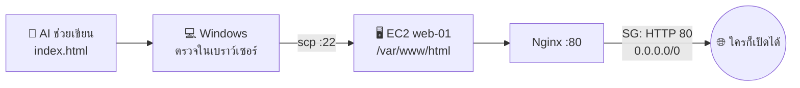

# LAB 02 · My First Web App 🌐

> **ICT24167 Network Management** · สัปดาห์ที่ 2 ของชุด AWS · เวลา 120 นาที
> [← LAB 01](lab01-aws-vpc-ec2-ssh.md) · [กลับหน้าหลัก](README.md)
> **ต้องทำ LAB 01 เสร็จก่อน** และต้องมี `web-01`, `lab-web-sg` และไฟล์ `lab-key.pem`

## 🎯 จบ Lab นี้แล้วทำอะไรได้

- [ ] ใช้ AI ช่วยเขียนหน้าเว็บประวัติส่วนตัว และ **อ่านเข้าใจ** โค้ดที่ได้
- [ ] ติดตั้ง **Nginx** บน EC2 แล้วเปิด **พอร์ต 80** ด้วย Security Group อย่างมีเหตุผล
- [ ] อัปโหลดไฟล์ขึ้นเซิร์ฟเวอร์ด้วย **`scp`** จาก CMD
- [ ] อ่าน **Access Log** เพื่อดูว่าใครเข้ามาที่เว็บ
- [ ] แยกอาการ **closed** กับ **filtered** ได้จากการทดลองจริง

## ⏱️ แผนเวลา

| Part | หัวข้อ | เวลา |
|---|---|---|
| 0 | เปิดเครื่องกลับมาใช้งาน | 10 นาที |
| 1 | ให้ AI ช่วยเขียนเว็บประวัติ | 25 นาที |
| 2 | ติดตั้ง Nginx + เปิดพอร์ต 80 | 20 นาที |
| 3 | อัปโหลดเว็บด้วย `scp` | 15 นาที |
| 4 | แชร์ให้เพื่อน + อ่าน Access Log | 15 นาที |
| 5 | Break & Fix: closed vs filtered | 20 นาที |
| 6 | มุมธุรกิจ + เก็บงาน | 15 นาที |



---

## Part 0 · เปิดเครื่องกลับมาใช้งาน (10 นาที)

1. Sign in AWS (Region **Singapore**) → EC2 → Instances → เลือก `web-01` → **Instance state › Start instance**
2. รอให้ขึ้น **Running** และ **3/3 checks passed**
3. จด **Public IPv4 ใหม่**: `________________`

> 🔮 Public IP ต่างจากสัปดาห์ที่แล้วหรือไม่? Private IP เปลี่ยนไหม? ทำไมจึงต่างกัน

4. SSH เข้าเครื่อง (เปิด CMD ในโฟลเดอร์ที่มี `lab-key.pem`)

```cmd
ssh -i lab-key.pem ubuntu@<Public IP ใหม่>
```

> [!TIP]
> ถ้าขึ้น `REMOTE HOST IDENTIFICATION HAS CHANGED` หรือ timeout ให้ตรวจว่าใช้ IP **ใหม่** แล้ว และกฎ SSH ใน SG ยังตรงกับ IP ของห้อง (ถ้าทำที่บ้านต้องแก้ My IP ใหม่)

---

## Part 1 · ให้ AI ช่วยเขียนเว็บประวัติ (25 นาที)

### 1.1 กติกาความเป็นส่วนตัว (PDPA) ก่อนเริ่ม

เว็บนี้จะเป็น **สาธารณะ** ทั้งโลกเปิดดูได้ และ Bot จะเก็บข้อมูลไป

| ✅ ใส่ได้ | ❌ ห้ามใส่ |
|---|---|
| ชื่อเล่น / ชื่อจริง (ตามสะดวก) | เลขบัตรประชาชน, รหัสนักศึกษาเต็ม |
| สาขา, ทักษะ, งานอดิเรก, โปรเจกต์ | เบอร์โทร, ที่อยู่บ้าน, วันเกิดเต็ม |
| ลิงก์ GitHub / LinkedIn | อีเมลส่วนตัวหลัก (ใช้อีเมลมหาวิทยาลัย หรือไม่ใส่เลย) |
| รูป Avatar / การ์ตูน | รูปถ่ายบัตร, รูปที่ระบุตำแหน่งบ้าน |

### 1.2 Prompt ตั้งต้น (คัดลอกไปแก้ในวงเล็บ)

ใช้ AI ที่ถนัด เช่น Claude, ChatGPT หรือ Gemini

```text
ช่วยเขียนหน้าเว็บประวัติส่วนตัวแบบหน้าเดียว (Single-page portfolio) ให้หน่อย

ข้อกำหนดทางเทคนิค:
- เป็นไฟล์เดียวชื่อ index.html ที่มี HTML + CSS อยู่ในไฟล์ (ไม่มีไฟล์แยก)
- ไม่ใช้ JavaScript framework และไม่โหลดไฟล์จากภายนอก ยกเว้น Google Fonts
- รองรับมือถือ (Responsive) และใส่ <meta charset="UTF-8"> เพื่อให้ภาษาไทยแสดงถูก
- ใส่ comment ภาษาไทยอธิบายแต่ละส่วนของโค้ดสั้น ๆ

เนื้อหา:
- ชื่อ: (ชื่อเล่นหรือชื่อที่อยากแสดง)
- สาขา: เทคโนโลยีสารสนเทศ มหาวิทยาลัยศรีปทุม
- เกี่ยวกับฉัน: (2-3 ประโยค)
- ทักษะ: (เช่น Networking, Packet Tracer, AWS, Linux)
- โปรเจกต์/ผลงาน: (1-3 อย่าง)
- ช่องทางติดต่อ: (GitHub / LinkedIn เท่านั้น)

สไตล์: (เช่น มินิมอล โทนมืด สีหลักฟ้า / น่ารักพาสเทล / แนว Terminal สีเขียว)
ท้ายหน้าเขียนว่า "Hosted on AWS EC2 · Nginx · ICT24167"
```

### 1.3 ตรวจโค้ดก่อนใช้

1. สร้างโฟลเดอร์ `C:\Users\<ชื่อผู้ใช้>\Downloads\mysite`
2. เปิด **Notepad** → วางโค้ดที่ได้จาก AI → **Save As**
   - File name: `index.html`
   - Save as type: **All Files (\*.\*)**
   - Encoding: **UTF-8**
3. ดับเบิลคลิก `index.html` เพื่อเปิดในเบราว์เซอร์ แล้วตรวจว่าภาษาไทยไม่เพี้ยนและดูดีบนจอมือถือ (กด `F12` แล้วกดไอคอนมือถือ)

> [!IMPORTANT]
> **AI เป็นผู้ช่วย ไม่ใช่ผู้รับผิดชอบ** คุณต้องตอบได้ว่าโค้ดทำอะไร ให้เติมตารางนี้ (หลักฐาน E2)

| Tag / CSS ที่พบในโค้ด | ทำหน้าที่อะไร (ด้วยคำพูดของตัวเอง) |
|---|---|
| `<meta charset="UTF-8">` | |
| `<meta name="viewport" ...>` | |
| `<section>` หรือ `<header>` | |
| `@media (max-width: ...)` | |
| (เลือกเองอีก 1 อย่าง) | |

> [!TIP]
> อยากแก้ดีไซน์ ให้สั่ง AI เป็นรอบ ๆ เช่น "เปลี่ยนสีหลักเป็นสีม่วง และเพิ่มส่วน Timeline การศึกษา" อย่าขอให้เขียนใหม่ทั้งหมดทุกรอบ

---

## Part 2 · ติดตั้ง Nginx และเปิดพอร์ต 80 (20 นาที)

### 2.1 ติดตั้งบน EC2 (ใน SSH)

```bash
sudo apt update
sudo apt install -y nginx
systemctl status nginx --no-pager    # ต้องเห็น active (running)
sudo ss -tlnp | grep :80             # Nginx ฟังพอร์ต 80 อยู่หรือไม่
curl -I http://localhost             # ทดสอบจากในเครื่อง ต้องได้ HTTP/1.1 200 OK
```

| ตรวจ | ผลที่ได้ |
|---|---|
| `systemctl status nginx` | |
| `ss -tlnp` เห็น `0.0.0.0:80` ไหม | |
| `curl -I http://localhost` บรรทัดแรก | |

### 2.2 🔮 ทำนาย แล้วทดสอบจากภายนอก

บน Windows เปิดเบราว์เซอร์ พิมพ์ `http://<Public IP>` (พิมพ์ `http://` ให้ครบ) และเปิด PowerShell

```powershell
Test-NetConnection <Public IP> -Port 80
```

| | ทำนาย | ผลจริง |
|---|---|---|
| เบราว์เซอร์ | | |
| `TcpTestSucceeded` | | |

<details>
<summary>💡 ทำไม Nginx ทำงานแล้วแต่เปิดเว็บจากข้างนอกไม่ได้</summary>

ใช้หลัก **ตรวจสามมุม** (Ch11): (1) บริการฟังอยู่ไหม → `ss` บอกว่าใช่ (2) ไฟร์วอลล์อนุญาตไหม → ดู Inbound rules ของ `lab-web-sg` (3) ภายนอกเห็นอะไร → timeout
ปัญหาจึงอยู่ที่ **Security Group** ไม่ใช่ Nginx

</details>

### 2.3 เพิ่มกฎ HTTP ใน Security Group

EC2 → Security Groups → `lab-web-sg` → **Edit inbound rules** → **Add rule**

| Type | Protocol | Port | Source | Description |
|---|---|---|---|---|
| HTTP | TCP | 80 | **Anywhere-IPv4** `0.0.0.0/0` | `public website` |

**Save rules** แล้วรีเฟรชเบราว์เซอร์ ต้องเห็นหน้า **Welcome to nginx!**

> 🔮 **คิดต่อ:** ทำไมพอร์ต 80 จึงเปิดให้ `0.0.0.0/0` ได้ แต่พอร์ต 22 ควรเปิดเฉพาะ My IP? (หลัก Least Privilege: ใครบ้างที่ **จำเป็น** ต้องเข้าแต่ละพอร์ต)

> [!NOTE]
> เบราว์เซอร์อาจขึ้นคำเตือน **Not secure** เพราะเว็บยังเป็น HTTP ไม่มีการเข้ารหัส (เรื่อง HTTPS จะเรียนในขั้นต่อไป) และถ้าเบราว์เซอร์พยายามเปิดเป็น `https://` เองแล้วค้าง ให้พิมพ์ `http://` ใหม่ให้ชัดเจน

---

## Part 3 · อัปโหลดเว็บของเราขึ้นเซิร์ฟเวอร์ (15 นาที)

### 3.1 วิธีหลัก: `scp` จาก CMD

`scp` (Secure Copy) ใช้ SSH พอร์ต 22 เหมือนเดิม จึง **ไม่ต้องเปิดพอร์ตเพิ่ม**

เปิด **CMD หน้าต่างใหม่** บน Windows (ไม่ใช่ในหน้าต่าง SSH):

```cmd
cd %USERPROFILE%\Downloads
scp -i lab-key.pem mysite\index.html ubuntu@<Public IP>:~/
```

กลับไปหน้าต่าง SSH แล้วย้ายไฟล์ไปที่โฟลเดอร์เว็บ:

```bash
ls -l ~/index.html                               # ไฟล์มาถึงแล้ว
sudo cp ~/index.html /var/www/html/index.html    # วางในโฟลเดอร์ที่ Nginx ให้บริการ
sudo chmod 644 /var/www/html/index.html          # ให้ทุกคนอ่านได้ แต่เจ้าของเท่านั้นที่แก้ได้
ls -l /var/www/html/
curl -s http://localhost | head -n 15            # ต้องเห็นโค้ดของเรา
```

รีเฟรชเบราว์เซอร์ที่ `http://<Public IP>` ต้องเห็น **เว็บประวัติของเรา** 🎉

<details>
<summary>💡 ทำไม index.html ของเราจึงแสดงแทนหน้า Welcome to nginx</summary>

ในโฟลเดอร์ `/var/www/html` มีไฟล์ `index.nginx-debian.html` (หน้า Welcome) อยู่แล้ว แต่ในไฟล์ตั้งค่า `/etc/nginx/sites-available/default` มีบรรทัด

```nginx
index index.html index.htm index.nginx-debian.html;
```

Nginx หาไฟล์ **ตามลำดับซ้ายไปขวา** และเจอ `index.html` ก่อน (หลักเรื่องลำดับเหมือนกฎไฟร์วอลล์เลย)

</details>

### 3.2 วิธีสำรอง: วางโค้ดผ่าน `nano`

ใช้เมื่อ `scp` มีปัญหา:

```bash
sudo nano /var/www/html/index.html
```

คัดลอกโค้ดทั้งหมดจาก Notepad → คลิกขวาในหน้าต่าง CMD เพื่อวาง → กด `Ctrl+O`, `Enter` เพื่อบันทึก → กด `Ctrl+X` เพื่อออก

### 3.3 แก้เว็บรอบถัดไป

แก้ไฟล์บน Windows → รันคำสั่ง `scp` เดิม → `sudo cp` เดิม → รีเฟรช (กด `Ctrl+F5` เพื่อล้าง Cache)

> [!TIP]
> **Checkpoint 3** 📸 เว็บของเราในเบราว์เซอร์ **โดยเห็น Address bar ที่เป็น Public IP** + ผล `ls -l /var/www/html/` (หลักฐาน E3)

---

## Part 4 · แชร์ให้เพื่อน + อ่าน Access Log (15 นาที)

### 4.1 แชร์ผ่าน QR Code

1. ในเบราว์เซอร์ Edge / Chrome คลิกขวาบนหน้าเว็บ หรือกดเมนู **Share** → **Create QR code**
2. ให้เพื่อน 2 คนสแกนด้วยมือถือ **ผ่านเน็ตมือถือ (ปิด Wi-Fi)** เพื่อทดสอบจากอินเทอร์เน็ตจริง

### 4.2 ดูว่าใครเข้าเว็บเรา

ในหน้าต่าง SSH:

```bash
sudo tail -f /var/log/nginx/access.log
```

ให้เพื่อนรีเฟรชเว็บ แล้วดูบรรทัดใหม่ที่เพิ่มขึ้น (กด `Ctrl+C` เพื่อหยุด)

```text
203.0.113.25 - - [15/Nov/2026:10:21:05 +0000] "GET / HTTP/1.1" 200 4821 "-" "Mozilla/5.0 (iPhone; ...)"
```

| ฟิลด์ | ค่าจาก Log ของเรา | ความหมาย |
|---|---|---|
| IP ผู้เข้าชม | | |
| เวลา (เขตเวลาอะไร?) | | |
| Method + Path | | |
| Status code | | |
| User-Agent (อุปกรณ์อะไร) | | |

### 4.3 🔍 นักสืบ: มีใครอีกบ้าง

```bash
sudo awk '{print $1}' /var/log/nginx/access.log | sort | uniq -c | sort -rn | head
sudo grep -v "GET / " /var/log/nginx/access.log | tail -n 10
```

> 🔮 มี IP แปลกหน้าที่ไม่ใช่เพื่อนเรา ขอ Path แปลก ๆ เช่น `/.env`, `/wp-login.php`, `/admin` หรือไม่? นี่คือ **Bot สแกนช่องโหว่** ที่วิ่งไปทั่วอินเทอร์เน็ตตลอดเวลา เว็บเพิ่งเปิดไม่กี่ชั่วโมงก็โดนแล้ว จึงเป็นเหตุผลที่ต้องเปิดพอร์ตให้น้อยที่สุด

---

## Part 5 · 💥 Break & Fix: closed vs filtered (20 นาที)

ทดลอง 2 สถานการณ์ แล้ววัดผลจาก Windows ด้วยคำสั่งเดียวกัน

```powershell
Measure-Command { Test-NetConnection <Public IP> -Port 80 -WarningAction SilentlyContinue } | Select-Object TotalSeconds
Test-NetConnection <Public IP> -Port 80
```

### สถานการณ์ A · ไฟร์วอลล์บล็อก

1. **Break**: ลบกฎ **HTTP 80** ออกจาก `lab-web-sg`
2. **Observe**: รันคำสั่งด้านบน และลองเปิดเว็บในเบราว์เซอร์
3. **Fix**: เพิ่มกฎ HTTP 80 กลับคืน

### สถานการณ์ B · บริการหยุดทำงาน

1. **Break** (ใน SSH): `sudo systemctl stop nginx`
2. **Observe**: รันคำสั่งเดิม และลองเปิดเว็บ
3. **Fix**: `sudo systemctl start nginx`

### บันทึกผล

| | สถานการณ์ A (SG ไม่มีพอร์ต 80) | สถานการณ์ B (Nginx หยุด) |
|---|---|---|
| ข้อความในเบราว์เซอร์ | | |
| `TcpTestSucceeded` | | |
| ใช้เวลา (วินาที) | | |
| สถานะตามศัพท์ nmap | **filtered / closed** | **filtered / closed** |

<details>
<summary>💡 ทำไมเวลาจึงต่างกันมาก</summary>

- **A:** Security Group **ทิ้งแพ็กเก็ตเงียบ ๆ** ไม่ตอบอะไรกลับ เครื่องเราจึงรอจนหมดเวลา → **filtered**
- **B:** แพ็กเก็ตผ่าน SG ไปถึงเครื่องได้ แต่ไม่มีโปรแกรมฟังพอร์ต 80 ระบบปฏิบัติการจึงตอบ **TCP RST** กลับทันที → **closed**

นี่คือหลักฐานจริงว่าปัญหาอยู่ที่ **ไฟร์วอลล์** หรือ **บริการ** ซึ่งเป็นทักษะแรกที่ทีม Support ต้องแยกให้ได้

</details>

> [!TIP]
> **Checkpoint 5** 📸 ตารางบันทึกผลที่กรอกครบ + ภาพหน้าจอ PowerShell ทั้ง 2 สถานการณ์ (หลักฐาน E5)

---

## Part 6 · มุมธุรกิจ + เก็บงาน (15 นาที)

### 6.1 ถ้าเว็บนี้เป็นของลูกค้าจริง

ใช้ [AWS Pricing Calculator](https://calculator.aws/) ประมาณค่าใช้จ่ายรายเดือนของเว็บนี้ (Region Singapore, เปิด 24 ชั่วโมง) แล้วตอบคำถาม

| คำถาม | คำตอบ |
|---|---|
| ค่า EC2 (Instance type ที่ใช้) ต่อเดือน | |
| ค่า Public IPv4 ต่อเดือน | |
| ค่า EBS 8 GiB ต่อเดือน | |
| **รวมโดยประมาณ** | |
| ถ้าเป็นเว็บประวัติแบบ Static ล้วน มีบริการอื่นที่ถูกกว่า EC2 ไหม (ลองค้นคำว่า *Amazon S3 static website* หรือ *AWS Amplify Hosting*) | |

### 6.2 สิ่งที่ยังขาดก่อนใช้งานจริง

| ปัญหาที่พบใน Lab | ทางแก้ในงานจริง |
|---|---|
| Public IP เปลี่ยนทุกครั้งที่ Stop/Start | Elastic IP |
| ต้องจำเป็นตัวเลข IP | Domain name + DNS (Route 53 หรือผู้ให้บริการอื่น) |
| เบราว์เซอร์ขึ้น Not secure | HTTPS ด้วยใบรับรองฟรีจาก Let's Encrypt |
| Bot สแกนเว็บตลอดเวลา | อัปเดต OS สม่ำเสมอ, เปิดพอร์ตให้น้อยที่สุด, WAF |

### 6.3 เก็บงาน

```bash
exit
```

EC2 → Instances → `web-01` → **Instance state › Stop instance**

> [!CAUTION]
> **เมื่อจบภาคเรียน** ให้ลบทรัพยากรทั้งหมดตามลำดับ เพื่อไม่ให้เครดิตถูกใช้ไปเรื่อย ๆ
> 1. EC2 → **Terminate** `web-01`
> 2. EC2 → Key Pairs → ลบ `lab-key`
> 3. VPC → Your VPCs → เลือก `lab-vpc` → **Actions › Delete VPC** (จะลบ Subnet, Route Table, IGW และ Security Group ที่ผูกอยู่ให้ด้วย ถ้าลบไม่ได้ให้ตรวจว่า Terminate Instance เรียบร้อยแล้ว)
> 4. Billing → **Credits** และ **Bills** ตรวจว่าไม่มีบริการค้าง

---

## 🧾 สรุปคำสั่งที่ใช้

| งาน | คำสั่ง |
|---|---|
| ติดตั้ง Nginx | `sudo apt update && sudo apt install -y nginx` |
| ตรวจบริการ | `systemctl status nginx` · `sudo ss -tlnp \| grep :80` · `curl -I http://localhost` |
| อัปโหลดไฟล์ (CMD) | `scp -i lab-key.pem mysite\index.html ubuntu@<IP>:~/` |
| วางไฟล์เว็บ | `sudo cp ~/index.html /var/www/html/index.html` |
| หยุด/เริ่มบริการ | `sudo systemctl stop nginx` · `sudo systemctl start nginx` |
| ดู Log สด | `sudo tail -f /var/log/nginx/access.log` |
| ทดสอบพอร์ต (PowerShell) | `Test-NetConnection <IP> -Port 80` |

## 🆘 แก้ปัญหาเร็ว

| อาการ | ตรวจอะไรก่อน |
|---|---|
| เบราว์เซอร์หมุนค้างจน timeout | SG ไม่มี HTTP 80 · ใช้ Public IP เก่า · พิมพ์เป็น `https://` |
| `This site can't be reached` / `refused` ทันที | Nginx ไม่ได้ทำงาน (`systemctl status nginx`) |
| ยังเห็นหน้า Welcome to nginx | ยังไม่ได้ `sudo cp` ไป `/var/www/html/` · ชื่อไฟล์ผิด (เช่น `index.html.txt`) · ลอง `Ctrl+F5` |
| ภาษาไทยเป็นตัวอักษรเพี้ยน | ไม่ได้ Save เป็น UTF-8 · ไม่มี `<meta charset="UTF-8">` |
| `scp: Permission denied` | ส่งไปที่ `~/` ก่อน แล้วค่อย `sudo cp` (ผู้ใช้ `ubuntu` เขียน `/var/www/html` ตรง ๆ ไม่ได้) |
| `403 Forbidden` | สิทธิ์ไฟล์ผิด ให้รัน `sudo chmod 644 /var/www/html/index.html` |

---

## 📦 Evidence Pack (100 คะแนน)

| รหัส | หลักฐาน | คะแนน |
|---|---|---|
| E1 | Prompt ที่ใช้จริง (ทุกรอบ) + ภาพเว็บที่เปิดจากเครื่อง Windows | 10 |
| E2 | ตารางอธิบายโค้ด 5 รายการ (1.3) ด้วยคำพูดของตัวเอง | 15 |
| E3 | เว็บเปิดผ่าน Public IP + `ls -l /var/www/html/` + Inbound rules ของ `lab-web-sg` (มีทั้ง 22 และ 80) | 20 |
| E4 | ตารางอ่าน Access Log (4.2) + ผลนักสืบ Bot (4.3) | 15 |
| E5 | Break & Fix ครบทั้ง 2 สถานการณ์พร้อมคำอธิบาย closed vs filtered | 20 |
| E6 | ตารางประเมินค่าใช้จ่าย 6.1 + ตอบคำถามบริการทางเลือก | 10 |
| E7 | **URL เว็บของเรา** (ส่งก่อน Stop Instance และผู้สอนอาจสุ่มเปิดในคาบ) | 10 |

### ✍️ สะท้อนคิด (โบนัส 5 คะแนน)

ถ้าต้องอธิบายให้คุณแม่ฟังว่า "เว็บของหนูไปอยู่บนอินเทอร์เน็ตได้อย่างไร" ใน 5 ประโยค โดยต้องมีคำว่า **Server, IP, Port, Firewall** ครบ จะเล่าว่าอย่างไร?

---

[← LAB 01](lab01-aws-vpc-ec2-ssh.md) · [กลับหน้าหลัก](README.md)
